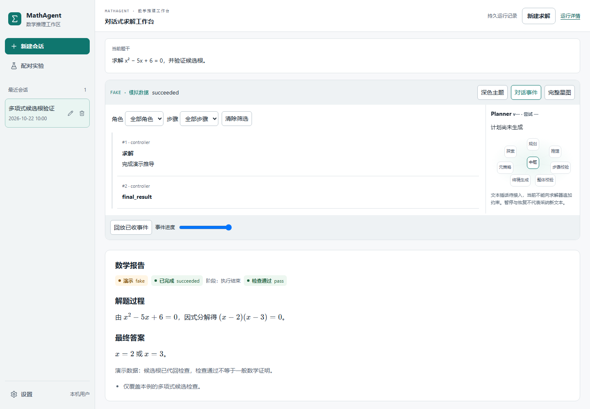
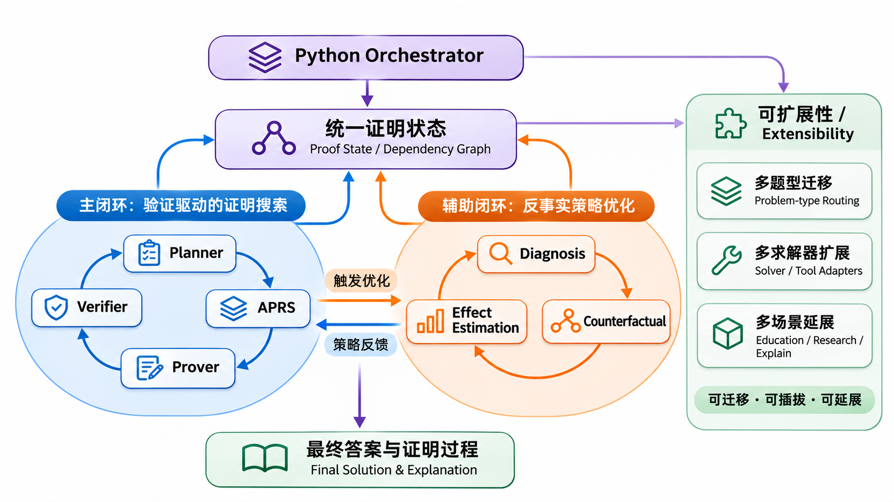

<p align="center">
  
</p>

<p align="center"><strong>English</strong> · <a href="README.zh-CN.md">简体中文</a></p>

# RiCL Runtime

This repository is moving toward a research-focused mathematics reasoning runtime. The current runnable Runtime is a deterministic, offline, single-route CLI example. It is not evidence of a ready model provider, completed research mechanisms, real-model runs, or improved mathematical performance.

<p align="center">
  
</p>

[**Run the offline CLI**](#run-the-offline-single-route-cli) · [**Runtime mechanisms and status**](#three-runtime-mechanisms) · [**Documentation index**](docs/README.md) · [**Legacy Showcase**](#legacy-showcase-web)

## Run the offline single-route CLI

From the repository root, run this deterministic example:

```shell
uv run python -m ricl_runtime --problem "Compute 2 + 2." --offline-answer "4"
```

The offline port returns the answer supplied by `--offline-answer`; it does not solve the problem with a model. The current independent verifier checks only integer addition in its supported prompt form. Other prompts have no applicable criterion and are recorded as `unknown`, not as verified. The CLI prints a JSON result and writes `run.json` and a redacted `trace.jsonl` beneath `artifacts/<run_id>/` by default. Pass `--output-root <path>` to write those artifacts elsewhere.

## Three Runtime mechanisms

These are separately scoped research mechanisms, not capabilities of the current single-route CLI. Their linked issues define the work and acceptance evidence.

| Mechanism | Current Runtime status and scope |
| --- | --- |
| **Shared Reasoning State** | Not in the current CLI. [Issue #239](https://github.com/RUSS0718/RiCL/issues/239) scopes verified-result storage, dependency validity, and consumption by later requests. |
| **Causal Search Loop** | Not in the current CLI. [Issue #240](https://github.com/RUSS0718/RiCL/issues/240) scopes APRS ranking on a fixed candidate set; [issue #241](https://github.com/RUSS0718/RiCL/issues/241) separately scopes serial candidate expansion and selection. |
| **Counterfactual Control** | Not in the current CLI. [Issue #242](https://github.com/RUSS0718/RiCL/issues/242) scopes isolated branches from one checkpoint and verified feedback into the main loop. |

## Read next

- [Documentation index](docs/README.md) for the current CLI entry, scoped work, decisions, and evidence status.
- [Development gates](docs/engineering/development-gates.md) for documentation checks and focused Runtime validation.
- [Repository instructions](AGENTS.md), [Runtime specification #236](https://github.com/RUSS0718/RiCL/issues/236), [offline CLI issue #237](https://github.com/RUSS0718/RiCL/issues/237), and [mechanism evidence order #232](https://github.com/RUSS0718/RiCL/issues/232) for constraints and acceptance boundaries.

## Legacy Showcase Web

The repository also retains a separate Showcase and official-evaluation path. It is not the RiCL Runtime CLI described above. The following instructions and historical design references apply only to that legacy path.

### Launch Showcase Web

Run these steps from the repository root. You need **uv, Python 3.11 or 3.12, Node.js 24, and npm**. The first dependency install requires internet access.

1. Set `INTERN_API_KEY` in an untracked `.env` file at the repository root.
2. Run the launcher. It installs locked dependencies, builds the Vue frontend, and starts a local Flask server.

   ```shell
   uv run --no-project python scripts/start_showcase.py web
   ```

3. Open [127.0.0.1:8090/dashboard](http://127.0.0.1:8090/dashboard) and submit a problem such as `Solve x² − 1 = 0 and check the candidate roots.` Submitting creates a Job and calls Intern.

Add `--mode fake` to try the interface without model credentials. Use `--port <port>` if the default port is in use. Press Ctrl+C to stop the service. Run data defaults to `artifacts/showcase-live/` in live mode and `artifacts/showcase-local/` in fake mode.

<details>
<summary>Workbench preview and Notebook launcher</summary>



This screenshot shows simulated data from a browser test. During a live run, the workbench displays public execution events, saved outputs from individual roles, and the final answer. The [Showcase rehearsal record](docs/evals/onsite-demo-209-20261118.md) describes the demo and replay coverage.

```shell
uv run --no-project python scripts/start_showcase.py notebook
```

JupyterLab opens a working copy of the [example notebook](examples/showcase.ipynb) on local port 8888. Select **Run → Run All Cells** to create a Job through the local Showcase HTTP API and read its execution events and answer. The Notebook launcher works without Node.js and supports `--mode fake`. Working copies and run data are stored in `artifacts/showcase-notebook/`.

</details>

### Showcase mechanism design

The historical Showcase design below is separate from the Runtime mechanisms listed above. Its contracts and diagrams do not establish that those mechanisms run in the current CLI.


MathAgent connects **reasoning actions, state changes, and verifiable progress**. Chapters 2–4 of the v0.6 technical report describe the design. The implementation contracts below specify the code paths, prerequisites, and validation scope.

| Mechanism | Technical design |
| --- | --- |
| **Dependency tracing and local rollback** | The proposition–inference graph records versions, provenance, and verification evidence. An inference requires **all** of its premises (AND). A proposition can remain valid with **any** independent valid support (OR). When the last valid support is withdrawn, invalidation propagates along the dependencies. A Checkpoint provides a state from which the run can resume. See the [proof graph contract](docs/engineering/faithful-s07-contract-exit-20261108.md). |
| **Verification-guided search** | Population persists candidate routes and their lineage. Rater, Pareto ranking, and APRS schedule work based on verified progress, differences between routes, and known resource costs. Routes share a budget for model calls, tools, and time. The scheduler counts repeated results only once toward overall progress. See the [serial APRS contract](docs/engineering/faithful-s08-contract.md) and [concurrent scheduling contract](docs/engineering/faithful-population-contract.md). |
| **Strategy intervention from a shared Checkpoint** | The system forks baseline and intervention branches from the same Checkpoint. It changes one registered reasoning action while holding the problem, model, tools, and budget fixed, then compares verified progress and cost. The current contract applies to supported serial steps at an explicit pause. The comparison informs repair strategy within those conditions. See the [intervention contract](docs/engineering/faithful-s10-contract.md). |

### Showcase architecture



The diagram shows the main search loop and the intervention loop from the technical report. Advanced mechanisms depend on the mode and service configuration. In `live` mode, Showcase calls the Intern service.

- **Solver orchestration**. The Python STAR Solver Harness coordinates Explore, Planner, Reasoner, Verifier, Meta, and Researcher. It manages role handoffs, Checkpoints, the shared budget, and persistent evidence. LangGraph runs workbench graphs and manages checkpoints. The Harness owns the STAR role loop. DeepAgents is available as an optional `AgentAdapter`. See the [framework boundary](docs/adr/0002-langgraph-deepagents-boundary.md).
- **Tiered verification**. The Verifier records independent review and evidence grades. A bounded deterministic tool check can reach L1. A supported Lean goal can reach L2 after kernel checking and a dependency audit. L3 also requires an independent review of how the formal specification corresponds to the original problem. Whole-solution model review is recorded as `LLM_REVIEWED`. See the [verification contract](docs/engineering/faithful-s09-contract.md).
- **Workbench and traceability**. The Vue workbench shows progress via the Flask Job API and server-sent events (SSE). It reads answers, public summaries, and available evidence from persisted records. The CLI uses the same API, and paired experiments have a review interface. See the [role output validation record](docs/engineering/role-stage-199-acceptance.md).

### Showcase development and advanced configuration

<details>
<summary>Manual startup, Vite hot reload, and CLI</summary>

Install the development dependencies and start a local backend from the repository root.

```powershell
uv sync --locked --all-groups
uv run python showcase_server.py --host 127.0.0.1 --port 8090 --mode fake --data-dir artifacts/showcase-local
```

Start Vite in another terminal and open [127.0.0.1:5174/dashboard-assets/](http://127.0.0.1:5174/dashboard-assets/). Vite proxies `/api` to local port 8090.

```powershell
Set-Location showcase/frontend/chat-frontend
npm ci --no-audit --no-fund
npm run dev -- --host 127.0.0.1
```

After running `npm run build`, visit the Flask `/dashboard` route to view the production build. From the repository root, check the service and create a local session with these commands.

```powershell
uv run python showcase_cli.py health
uv run python showcase_cli.py session create
```

After configuring credentials, start the backend with `--mode live --data-dir artifacts/showcase-live` to use Intern. The CLI `probe` command creates a Job and calls the model. See the [Demo and CLI guide](docs/demo.md).

</details>

<details>
<summary>Enable image input or configure the Faithful service</summary>

- **Image input**. Set `$env:SHOWCASE_VISION_ENABLED = '1'` in PowerShell before starting the live Web launcher. The workbench accepts text, one PNG, or both. The PNG limit is 128 KiB. Image interpretation shares the Job budget with solving. See the [multimodal intake contract](docs/engineering/showcase-multimodal-intake.md).
- **Faithful service**. Copy the [example configuration](examples/faithful-service.json), then check the Docker image required by isolated tools, the budget, and the model context policy. Use your configured file path in these commands. The readiness check runs separately from Job submission.

```shell
uv run python showcase_server.py --mode live --faithful-config examples/faithful-service.json --check-runtime
uv run --no-project python scripts/start_showcase.py web --faithful-config examples/faithful-service.json --data-dir artifacts/faithful-local
```

You can enable `adaptive_solving` in supported configurations. Complete candidates go to independent whole-solution review. A specific mathematical objection can trigger one local repair before the solver returns to planning. See the [high-budget configuration example](examples/faithful-service-high-budget.json) and the [adaptive solving contract](docs/engineering/adaptive-solving-185-contract.md).

</details>

### Showcase validation and historical references

The official evaluation uses [`user_agent.ReasoningAgent`](user_agent.py). [BASELINE.json](BASELINE.json) records the official baseline file hashes and evaluation results. Showcase runs through separate entry points. Interpret the report's ablation results within their respective datasets, denominators, and budgets. The repository validation records document the scope of the evidence for each capability.

| Topic | Reference |
| --- | --- |
| Current version, implementation status, and evidence | [Documentation index](docs/README.md) |
| Dependency use in live runs, Lean attempts, and validation scope | [Mechanism validation](docs/evals/mechanism-206-20261118.md) |
| Live model readiness, paired experiments, and release history | [Readiness record](docs/evals/provider-live-natural-20261106-readiness-31.md) · [v0.2 release evidence](docs/evals/v0.2-release-evidence.md) |
| Fast, full offline, release, and frontend checks | [Engineering checks](docs/engineering/development-gates.md) |
| Merge criteria for the official evaluation path and Showcase | [Release boundary](docs/release-boundary.md) |

<details>
<summary>Local validation commands</summary>

```shell
uv run python scripts/check_fast.py
uv run python scripts/check.py --offline
uv run python scripts/check_showcase_release.py
```

From `showcase/frontend/chat-frontend/`, run `npm ci --no-audit --no-fund`, `npm audit --audit-level=high`, and `npm run check`. For coverage and scope, see the [engineering checks](docs/engineering/development-gates.md).

</details>
