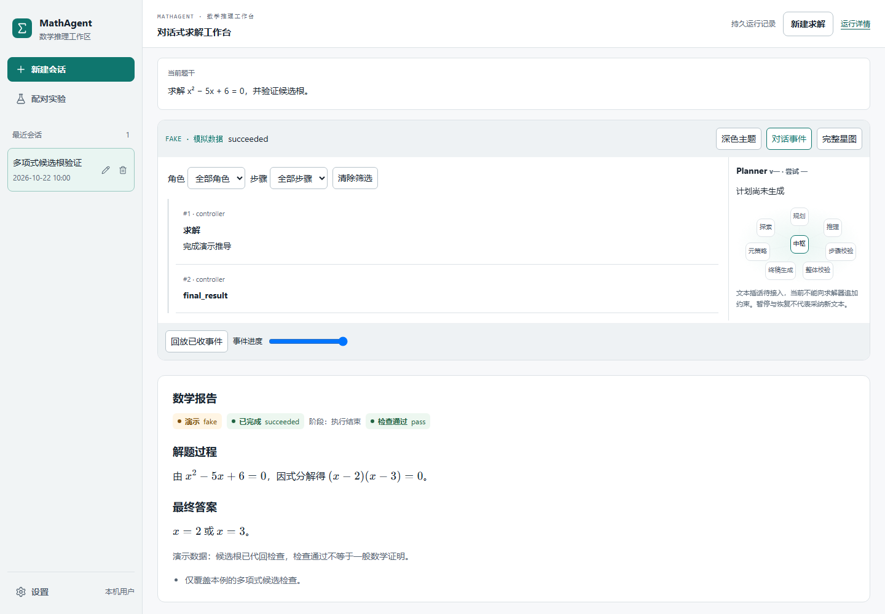
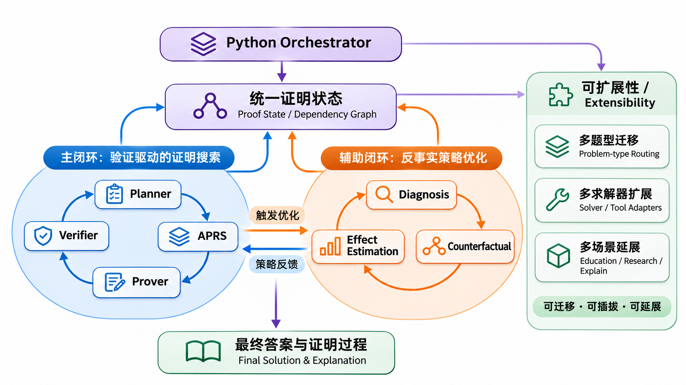

<p align="center">
  
</p>

<p align="center"><a href="README.md">English</a> · <strong>简体中文</strong></p>

# RiCL Runtime

RiCL Runtime 是用于数学推理研究的 Python 入口。它能运行单题，并记录独立验证、资源用量和脱敏 Trace，供后续复核。

<p align="center">
  
</p>

[**运行离线 CLI**](#运行离线单路线-cli) · [**Runtime 机制与状态**](#三项-runtime-机制) · [**文档索引**](docs/README.md) · [**旧版 Showcase**](#旧版-showcase-web)

## 运行离线单路线 CLI

在仓库根目录运行以下确定性样例：

```shell
uv run python -m ricl_runtime --problem "Compute 2 + 2." --offline-answer "4"
```

离线端口直接返回 `--offline-answer` 提供的答案，不会调用模型解题。当前独立验证器仅检查符合其支持形式的整数加法题。其他题目没有适用判据，状态记为 `unknown`，而不是已验证。CLI 会打印 JSON 结果，并默认将 `run.json` 和脱敏后的 `trace.jsonl` 写入 `artifacts/<run_id>/`。传入 `--output-root <path>` 可将产物写到其他位置。

## 三项 Runtime 机制

离线配对先导用受控算术夹具运行三项机制。

| 机制 | 当前 Runtime 状态与范围 |
| --- | --- |
| **Shared Reasoning State（共享推理状态）** | 使用 `--reasoning-state --model-request-limit 2` 核对后续请求引用的证据。[Issue #239](https://github.com/RUSS0718/RiCL/issues/239) |
| **Causal Search Loop（因果搜索循环）** | 使用 `--population --model-request-limit 2` 运行串行扩展和 APRS 排序。添加 `--no-aprs` 可运行普通搜索。[Issue #240](https://github.com/RUSS0718/RiCL/issues/240)、[Issue #241](https://github.com/RUSS0718/RiCL/issues/241) |
| **Counterfactual Control（反事实调控）** | 运行离线配对先导，核对同源分支及进入父路线后续请求的已验证反馈。[Issue #242](https://github.com/RUSS0718/RiCL/issues/242) |

## 接下来阅读

- [文档索引](docs/README.md)：当前 CLI 入口、独立机制范围、决策与证据状态。
- [离线配对先导命令](docs/README.md#离线配对先导)和[首轮 DeepSeek smoke 证据](docs/evals/runtime-deepseek-smoke.md)。
- [开发门禁](docs/engineering/development-gates.md)：文档检查与 Runtime 聚焦验证。
- [仓库指引](AGENTS.md)、[Runtime 规格 #236](https://github.com/RUSS0718/RiCL/issues/236)、[离线 CLI Issue #237](https://github.com/RUSS0718/RiCL/issues/237)及[机制证据顺序 #232](https://github.com/RUSS0718/RiCL/issues/232)：研究边界和验收条件。

## 旧版 Showcase Web

仓库仍保留独立的旧版 Showcase 与官方评测路径。它们不是上文介绍的 RiCL Runtime CLI。以下说明和历史设计只适用于旧路径。

### 一键启动 Showcase Web

在仓库根目录运行。需要 **uv、Python 3.11 或 3.12、Node.js 24 和 npm**。首次安装依赖需要联网。

1. 在仓库根目录未跟踪的 `.env` 中设置 `INTERN_API_KEY`。
2. 启动工作台。脚本会安装锁定依赖、构建 Vue 前端并启动本机 Flask 服务。

   ```shell
   uv run --no-project python scripts/start_showcase.py web
   ```

3. 打开 [127.0.0.1:8090/dashboard](http://127.0.0.1:8090/dashboard)，提交题目，例如 `求解 x² − 1 = 0，并检查候选根。`。发送题目会创建 Job 并调用 Intern。

只体验界面时，追加 `--mode fake`，无需模型凭证。端口冲突时追加 `--port <端口>`。按 Ctrl+C 停止服务，运行数据默认保存在 `artifacts/showcase-live/` 或 `artifacts/showcase-local/`。

<details>
<summary>查看工作台预览与 Notebook 入口</summary>



上图是浏览器测试的模拟快照。真实运行时可在工作台查看公开执行事件、角色阶段成果和最终答复。现场演示和回放范围见 [Showcase 彩排记录](docs/evals/onsite-demo-209-20261118.md)。

```shell
uv run --no-project python scripts/start_showcase.py notebook
```

JupyterLab 在本机 8888 端口打开[示例 Notebook](examples/showcase.ipynb)的工作副本。选择 **Run → Run All Cells**，通过本机 Showcase HTTP API 创建 Job，读取执行事件与答复。Notebook 无需 Node.js，也支持 `--mode fake`。副本和任务数据保存在 `artifacts/showcase-notebook/`。

</details>

### Showcase 机制设计

以下旧版 Showcase 设计与上文列出的 Runtime 机制相互独立。其合同和图示不能证明当前 CLI 已运行这些机制。


这里的“因果启发”指把**推理动作、状态变化和可验证进展**联系起来。技术报告 v0.6 第 2–4 章给出了三项机制的设计。下面的合同记录对应的代码路径、适用条件和验收范围。

| 机制 | 技术设计 |
| --- | --- |
| **依赖追溯与局部回退** | 命题–推导图记录版本、来源和验证证据。一次推导的前提是 **AND**，同一命题的多个有效支撑是 **OR**。撤销一个支撑时，仍有独立支撑的命题可继续使用。最后一个有效支撑消失时，沿依赖关系传播失效，并从 Checkpoint 恢复适用的状态。见[证明图合同](docs/engineering/faithful-s07-contract-exit-20261108.md)。 |
| **验证反馈驱动搜索** | Population 持久保存候选路线与谱系。Rater、Pareto 与 APRS 根据已验证的目标进展、路线差异和已知资源成本安排下一步。共享预算统一计入模型、工具与时间，重复成果在总进展中去重。见[串行 APRS 合同](docs/engineering/faithful-s08-contract.md)和[并发调度合同](docs/engineering/faithful-population-contract.md)。 |
| **同源策略干预** | 从同一 Checkpoint 派生基线与干预分支，固定题目、模型、工具和预算，只改变一个登记的推理动作，再比较验证进展与成本。当前工程合同限定在显式暂停、受支持的串行步骤。结果用于比较修复策略，因果解释限于该比较的设置。见[干预工程合同](docs/engineering/faithful-s10-contract.md)。 |

### Showcase 架构



上图描述技术报告中的主循环与干预循环。高级机制按模式和服务配置启用，`live` 表示调用真实 Intern 服务。

- **求解控制面**：Python STAR Solver Harness 编排 Explore、Planner、Reasoner、Verifier、Meta 和 Researcher，管理角色交接、Checkpoint、共享预算和持久证据。LangGraph 承载工作区图执行与检查点。STAR 的角色循环由 Harness 管理，DeepAgents 通过 `AgentAdapter` 提供可选适配。见[框架边界](docs/adr/0002-langgraph-deepagents-boundary.md)。
- **分层验证**：Verifier 记录独立审查与证据等级。确定性工具的有限检查最高为 L1。受支持的 Lean 目标通过内核及依赖审计后可达 L2，再经独立的原题与形式规格对应审查才可达 L3。整题模型审查单独记录为 `LLM_REVIEWED`。见[分层验证合同](docs/engineering/faithful-s09-contract.md)。
- **交互与追溯**：Vue 工作台通过 Flask Job API 与 SSE 展示进展，从持久记录读取答复、公开摘要及可用证据。CLI 使用同一组服务接口，配对实验另有审阅入口。运行记录和观测范围见[角色阶段成果验收](docs/engineering/role-stage-199-acceptance.md)。

### Showcase 开发与高级配置

<details>
<summary>手动启动、Vite 热更新与 CLI</summary>

在仓库根目录安装开发依赖并启动本机后端。

```powershell
uv sync --locked --all-groups
uv run python showcase_server.py --host 127.0.0.1 --port 8090 --mode fake --data-dir artifacts/showcase-local
```

另开一个终端启动 Vite，打开 [127.0.0.1:5174/dashboard-assets/](http://127.0.0.1:5174/dashboard-assets/)。Vite 将 `/api` 代理到本机 8090 端口。

```powershell
Set-Location showcase/frontend/chat-frontend
npm ci --no-audit --no-fund
npm run dev -- --host 127.0.0.1
```

执行 `npm run build` 后也可从 Flask 的 `/dashboard` 访问构建产物。在仓库根目录运行以下命令检查服务和创建会话。

```powershell
uv run python showcase_cli.py health
uv run python showcase_cli.py session create
```

配置凭证后，可将后端切换至 `--mode live --data-dir artifacts/showcase-live`。CLI 的 `probe` 会创建 Job 并调用真实模型。详见 [Demo 与 CLI 使用说明](docs/demo.md)。

</details>

<details>
<summary>启用图文读题或 Faithful 服务</summary>

- **图文读题**：启动 live Web 前，在 PowerShell 设置 `$env:SHOWCASE_VISION_ENABLED = '1'`。普通工作区支持单张 PNG、纯文本或文字加图。PNG 上限为 128 KiB，读图和求解共用任务预算。见[图文读题合同](docs/engineering/showcase-multimodal-intake.md)。
- **Faithful 服务**：复制[配置示例](examples/faithful-service.json)，核对隔离工具所需的 Docker 镜像、预算和模型上下文策略。使用填写好的本地配置路径。就绪检查有独立入口，普通模式的模型请求从提交 Job 开始。

```shell
uv run python showcase_server.py --mode live --faithful-config examples/faithful-service.json --check-runtime
uv run --no-project python scripts/start_showcase.py web --faithful-config examples/faithful-service.json --data-dir artifacts/faithful-local
```

适用配置中可显式启用 `adaptive_solving`。完整候选进入独立整题审查，明确异议最多触发一次局部修正，再转入规划。预算许可见[高预算配置示例](examples/faithful-service-high-budget.json)，策略范围见[自适应求解合同](docs/engineering/adaptive-solving-185-contract.md)。

</details>

### Showcase 验收与历史参考

官方客观评测使用 [`user_agent.ReasoningAgent`](user_agent.py)。官方 baseline 的文件哈希和评测结果见 [BASELINE.json](BASELINE.json)，Showcase 通过独立入口运行。报告中的消融按题集、分母和预算解读，数学能力结论以仓库中可复核的评测证据为准。

| 想了解 | 入口 |
| --- | --- |
| 当前版本、实现状态与证据 | [文档索引](docs/README.md) |
| 真实依赖消费、Lean 尝试与适用范围 | [机制专项验收](docs/evals/mechanism-206-20261118.md) |
| 真实模型就绪、对照实验及历史发布 | [就绪记录](docs/evals/provider-live-natural-20261106-readiness-31.md) · [v0.2 发布证据](docs/evals/v0.2-release-evidence.md) |
| 快速、离线完整、发布与前端检查 | [工程门禁](docs/engineering/development-gates.md) |
| 官方评分路径与 Showcase 的合并纪律 | [发布边界](docs/release-boundary.md) |

<details>
<summary>本地检查命令</summary>

```shell
uv run python scripts/check_fast.py
uv run python scripts/check.py --offline
uv run python scripts/check_showcase_release.py
```

在 `showcase/frontend/chat-frontend/` 执行 `npm ci --no-audit --no-fund`、`npm audit --audit-level=high` 和 `npm run check`。各检查覆盖范围见[工程门禁](docs/engineering/development-gates.md)。

</details>
