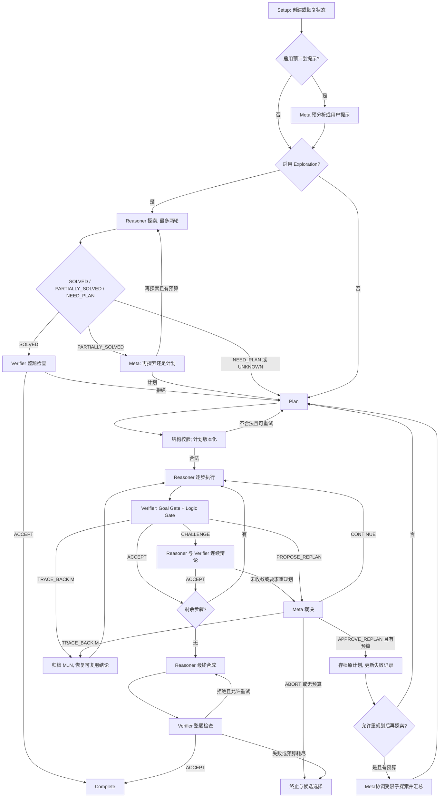

# STAR Core 完整工程化产品需求文档（PRD）

> 文档 ID：STAR-CORE-PRD　版本：1.2（Best-Effort 扩展与技术方案联动）　日期：2026-10-22  
> 状态：待本地实现与验收。本文描述目标系统，不表示这些功能已在上一版 `harness_lab` 中完成。  
> 适用项目：`RUSS0718/MathAgent` 的独立实验侧车。  
> 对应实施规格：[`STAR_CORE_SPEC_AGENT_v1_2.md`](STAR_CORE_SPEC_AGENT_v1_2.md)。两个文档共享 `SC-001` 至 `SC-043` 需求编号，含义必须一致。

> 版本沿革：v1.1 完成 SC-028..SC-038 与 AC-21..AC-33 的 STAR 核心审计；v1.2 另加 SC-039..SC-043 与 AC-34..AC-44，定义预算耗尽时的证据驱动兜底交付。v1.1 原件保留。对照表：[`STAR_CORE_COMPONENT_AUDIT.md`](STAR_CORE_COMPONENT_AUDIT_v1_1.md)。本规格尚未在用户仓库实现。  
> 保真度声明：对照公开论文及仓库源码的关键方法，但未对官方仓库做锁定 Commit 的逐函数覆盖审计与真实端到端复现，不应宣称已经证明“完全无遗漏”。

## 1. 产品定位与验收边界

### 1.1 交付物是什么

交付一个面向**固定题目的数学竞赛解题**系统。系统用确定性 Orchestrator 协调 Reasoner、Verifier 和持久化 Meta-Strategist，完整实现 STAR-PólyaMath 的核心控制协议：前期探索、计划分解、逐步执行、带历史的质询、定点回退、重新规划、结果整理与整题验证。

目标是**复现核心行为与可观测的工程协议**，而不是复刻 GitHub Copilot CLI 内部机制、复制其专有模型能力，或保证复现论文分数。v1.2 另定义可开关的 Best-Effort Finalization：在不新增预算外模型调用的前提下，保留最佳可用候选，给出非数值证据等级及可追踪理由。此功能属于 **[本项目扩展]**，不是 STAR 原论文已验证的机制。

### 1.2 使用者与使用场景

- **本地开发者**：按阶段实现并测试完整 STAR Core；可以读到每次状态变化及其原因。
- **实验人员**：使用统一模型和统一预算，单独打开或关闭组件，测量成功率、调用量、费用与延迟。
- **比赛提交者**：只有在单独通过官方入口、预算和评分合同验收后，才考虑将实验结果整合到正式路径。

典型路径：读入自然语言题目，系统可先用探索阶段尝试直接解答。困难题进入结构化规划，并按步骤接受审查。发现早期错误时，系统回退；发现计划不可挽救时，Meta-Strategist 决定是否换计划。最终产生可判分答案及其状态。

### 1.3 成功定义与非目标

**产品成功**：每个受支持的状态转移都可复现；每个模型调用与工具调用可追踪；已接受的数学结论保留来源及验证级别；中断后能恢复；禁用功能时无额外调用；原比赛默认路径不变。

**实验成功**：可以在同一问题、同一模型、同一环境和明确预算下重复运行，并导出独立的正确率与成本数据。工程验收通过**不等于**数学正确率提高。

本期不包含：Danus Fact Graph、SHEAF 动态 Lean DAG、OSVerify 双重错误审查、双向搜索树交汇、Moonshine 猜想管理、PackingStar 专用搜索，以及大规模训练。相关功能只通过未来扩展接口接入，不属于完整 STAR Core 的交付条件。

### 1.4 来源与实现差异

本文用三个标签区分要求来源：**[论文]** 是 STAR 论文明确描述的控制机制；**[官方代码]** 是公开仓库中可确认的运行行为和默认值；**[本项目]** 是为兼容 MathAgent、可测试性和安全性制定的实现合同。若存在差异，本项目必须记录，不可误称“逐字节复现 STAR”。

例如，STAR 论文采用 Copilot CLI 会话与 `PROBLEM_STATE.md` 注入。[本项目]允许同一模型 API 搭配等价的显式历史恢复，但必须验证上下文隔离和跨尝试持久性。再例如，官方代码某些异常路径可能接受未经整题审查的输出。[本项目]要求这种输出标为 `completed_unverified`，不得标为已通过验证。

## 2. 系统边界与总体架构

### 2.1 一套控制器、三个角色

| 角色 | 承担的工作 | 不允许做什么 |
| --- | --- | --- |
| **Orchestrator** | 控制阶段、解析结构化结果、检查预算、保存状态、管理会话、回退与归档 | 不自行生成数学结论；不根据自由文本猜测控制动作 |
| **Reasoner** | 探索、拟定计划、推导步骤、答辩、运行允许的本地代码、合成答案 | 不修改状态主记录；不宣布自己已被独立验证 |
| **Verifier** | 检查步骤目标是否完成、数学逻辑是否成立、验证标签和代码证据，返回明确裁决 | 不改计划主文件；不能以沉默或解析失败代替 `ACCEPT` |
| **Meta-Strategist** | 跨计划保持历史；诊断超时、代码问题和僵局；发具体行动指令、裁定回退或重规划；在官方后重规划探索场景可调度受限研究子任务 | 不直接撰写正式证明、执行任意代码或修改权威状态；子任务委派须受编排器批准并计入预算 |

这是**角色与权限**划分，不要求四个不同模型。单一后端模型可通过不同系统提示词、会话生命周期与工具权限承担三种 LLM 角色。

### 2.2 总体控制流



说明：重规划后再探索在官方代码中可由 Meta 调度若干**只做研究探索、不执行代码的辅助子 Agent**；不能把它简化为一次普通 Explore 重试。由 `reexplore_after_replan` 控制，所有委派都必须受统一调用及探索预算管理。图中的 `ACCEPT` 指 LLM Verifier 接受，不指 Lean 等形式系统证明。

### 2.3 本地项目隔离 [SC-001]

新系统通过显式实验入口运行，不自动进入 `user_agent.ReasoningAgent`。保留 `user_agent.py`、`implementations/`、默认预算和现有实验 Runner 的原有行为。新增文件放在独立包路径；日志放在被忽略的 `artifacts/<run_id>/` 下。任何变更正式入口的工作都需要单独审批、配对实验和回归测试。

### 2.4 确定性状态机 [SC-002]

控制信号只从规定字段读取。Orchestrator 根据当前状态、裁决和剩余预算选下一节点。模型返回“我认为应该回退”这句话，不得绕过结构化结果直接触发回退。禁止状态机出现无上限循环；每个循环都有计数或截止时间。

## 3. 五个阶段的完整行为

### 3.1 Setup：建立可恢复的运行 [SC-016]

系统先校验输入、分配 `run_id`、创建题目哈希和工作目录，再加载已有快照或初始化状态。恢复已有 Run 时必须验证原题哈希、配置哈希和模型配置；冲突则拒绝继续，不能把另一道题的状态接进来。每个写状态的动作要么全部完成，要么能在下次启动时从事件记录安全恢复。

### 3.2 Exploration：先探索再决定是否规划 [SC-003]

Reasoner 在受限时间内枚举小例子、寻找模式、记录失败方向和候选思路。每轮输出四类评估之一：`SOLVED`、`PARTIALLY_SOLVED`、`NEED_PLAN`、`UNKNOWN`，同时给出工作成果、失败记录和候选方案。

- `SOLVED`：在**当前 Exploration Reasoner 会话中**继续润色候选完整解，再由一个新的 Verifier 整题审查。仅当审查返回 `ACCEPT`，才跳过规划并直接结束。若审查不通过，保留探索结果并进入 Planning。
- `PARTIALLY_SOLVED`：Meta-Strategist 根据已有结果决定再次探索还是进入 Planning。不得超过探索轮数上限。
- `NEED_PLAN` 或 `UNKNOWN`：归档本轮，进入 Planning；不得将猜测伪装成定理。
- 探索失败或超时：记录失败，受预算约束进入 Planning 或终止。不能静默丢失工作成果。

**来源**：[论文] 与 [官方代码]；原系统默认最多探索两轮，探索解出时可提前结束。

### 3.3 Pre-planning 与 Planning：形成可审查的步骤 [SC-004, SC-005]

预计划策略输入可采用三种模式：`none`、`meta_auto`、`user_hint`。`meta_auto` 调用 Meta-Strategist，指出适用方法和潜在误读，但不代替 Reasoner 证明；`user_hint` 保存提示来源，防止把人工帮助误报为全自动。

Reasoner 将题目和探索成果分成有顺序的步骤。通常建议 6 至 10 步；最多 20 步。每个步骤至少有 `step_id`、`title` 和 `objective`。如果有依赖信息，必须引用合法步骤 ID。Orchestrator 只验证编号、格式、上限、依赖引用和顺序，不假装检验计划的数学正确性。

格式不合法时进行有限次修订。修改后的计划生成新版本或修订号。遇到预算耗尽、结构仍不合法的情况，报告不完整状态。

### 3.4 Step execution：一次处理一个可检查目标 [SC-006, SC-007]

Reasoner 读取当前步骤、先前已接受的成果及其证据级别、当前提示和必要的失败信息。Reasoner 输出步骤报告，包括：目标、推理正文、非平凡断言的验证标签、可执行计算证据（如适用）、结论和是否受阻。

采用三类标签：

| 标签 | 允许使用的场景 | 证据含义 |
| --- | --- | --- |
| `[verified]` | 实际执行了计算，并保留输入、代码版本、输出和检查记录 | 说明计算执行过；不等于通用数学定理已形式化证明 |
| `[easy-verify]` | 可用短计算或明确检查验证，但本次尚未执行 | Verifier 应独立运行或核算；不能直接当作已验证 |
| `[hard-verify]` | 主要依赖数学推理，不能由短计算验证 | 需要完整逻辑审查；即使接受也只是 LLM 审查通过 |

Verifier 还可以提取 `[Lemma]`、`[Conjecture]`、`[Computation]`、`[Definition]` 和 `[Answer]` 等结果类别，分别记录类别和出处。被接受的事实也不能默认拥有形式化正确性保证。[SC-027]

### 3.5 Verification：两个 Gate 决定是否推进 [SC-008]

**Goal Gate** 判断 Reasoner 实际完成的内容是否满足计划中该步骤的目标，输出 `YES`、`PARTIAL` 或 `NO`。**Logic Gate** 检查使用的前提、计算、引理、量词和论证链是否成立，并核对每种标签的证据。

只有 Goal Gate 为 `YES` 且 Logic Gate 为 `PASS`，并且 Verifier 明确返回 `ACCEPT`，才能接受当前步骤。其他结果必须有后续操作。

Verifier 的合法裁决：

| 裁决 | 要求 | 下一步 |
| --- | --- | --- |
| `ACCEPT` | 两个 Gate 均通过 | 保存可归属成果，进入下一步骤 |
| `CHALLENGE` | 包含可定位疑点与修复请求 | 进入带上下文的 Challenge Loop |
| `TRACE_BACK` | 必须包含合法 `trace_back_to = M` | 回退步骤 M 至当前步 |
| `PROPOSE_REPLAN` | 说明当前计划为何不能局部修复 | 交给 Meta-Strategist 裁决 |

非法裁决、缺失 `M`、不认识的标签、格式错误、模糊接受，都不得自动转为 `ACCEPT`。可以先做一次受限格式修复；仍失败则产生解析错误并由控制器升级处理。[SC-020]

### 3.6 Challenge Loop：延续争论，不是无记忆重问 [SC-009]

一次 Challenge 包含 Reasoner 对明确指控的回应与 Verifier 的再审查。Reasoner 可辩护、举证或修改报告。**同一步中的 Reasoner 与 Verifier 都必须保留这场辩论的历史**，不能把每轮缩减成“再检查一次”。

接受条件仍是两个 Gate 通过。不同步数之间，Verifier 必须建立新会话，避免将前一结论当作无法挑战的默认真理。

每步辩论轮数上限来自配置，STAR 参考值为 5。达到上限仍不收敛时，产生 `STALEMATE` 并升级给 Meta-Strategist。不要自动判 Reasoner 胜，也不要无限辩论。

### 3.7 Trace-Back：撤销失效链并保留证据 [SC-010]

若当前步骤 N 暴露出更早步骤 M 的错误，系统将步骤 `M..N` 的现役报告与辩论记录归档；将这些步骤重置为待求解；撤销它们贡献的活动结论；递增尝试序号并重建 Reasoner 会话。

系统保留不依赖错误前提、并有证据支持的中间结论作为 `rescued_results`，但必须标记验证级别和依赖信息。已归档失败的报告可用于未来规划，却不能直接重新进入“已接受结论”。回退目标不合法时进入升级流程，不猜测一个附近步骤。

### 3.8 Re-plan：让 Meta 决定是否放弃整条路线 [SC-011, SC-012]

触发包括：Verifier 的 `PROPOSE_REPLAN`、Reasoner 明确报告计划受阻、Challenge 僵局、重复超时，以及步骤 1 反复失败（若启用该规则）。Meta-Strategist 的会话要跨计划版本持久存在，其输入是计划摘要、步骤完成情况、错误类型、历史失败、重试次数和剩余预算；Meta 不负责现场证明数学定理。

Meta 只能输出四种结构化决策：

- `CONTINUE`：继续当前计划；同时给出具体下一步或要澄清的问题。
- `TRACE_BACK`：指定合法目标 M，交由 Orchestrator 执行回退。
- `APPROVE_REPLAN`：说明计划失败原因，记录 `forbidden_directions` 和 `reusable_results`，归档旧计划。新计划使用新的 Reasoner 尝试会话。
- `ABORT`：停止。保留已接受的部分成果和清楚的不完整标记。

每题最多 3 次 Re-plan 是 STAR 论文的参考上限。每次 Re-plan 都保存历史，不能用新计划覆盖失败证据；`forbidden_directions` 是在给定上下文下的策略提示，不等于数学上已证伪的定理。

### 3.9 Final solution：重新检查整篇答案 [SC-013]

所有计划步骤获得接受后，由 Reasoner 合成面向用户的完整解答。Verifier 使用**新的整题审查会话**，检查题目对应关系、结论是否回答原问题、跨步骤依赖、遗漏条件和最终答案格式。

整题审查失败时，在预算内修订并再次审查；STAR 参考 `MAX_SOLUTION_RETRIES = 2`。如果审查调用失败而系统仍需返回一个候选答案，必须标为 `completed_unverified`，不能报告 `completed_verified`。探索提前解出也遵循同一原则。

## 4. 会话、记忆与文件

### 4.1 会话生命周期 [SC-015]

| 角色 | 保留范围 | 重新开会话的条件 |
| --- | --- | --- |
| Reasoner | 同一计划尝试中的多个步骤及其辩论 | Trace-Back 或 Re-plan 后 |
| Verifier | 同一步的全部 Challenge 轮次 | 新步骤或整题审查时 |
| Meta-Strategist | 同一题的完整生命周期 | 题目变更或新 Run |
| Exploration Reasoner | 每轮独立；上一轮通过状态视图继承 | 每次 Exploration round |

若当前模型客户端没有原生 session resume，适配器必须在请求中重建相同的角色历史。**持久化的不只是摘要，而是能保证后续决策不失去关键先前反馈的上下文**。若历史被截断，记录截断规则与可访问范围。

### 4.2 状态投影与注入 [SC-015, SC-016]

每次角色调用前，Orchestrator 从同一份状态构造不同视图：

- **Reasoner 视图**：原题、当前目标、先前已接受步骤及证据、相关失败、工具状态。
- **Verifier 视图**：原题、计划目标、当前报告、先前可用结论及其验证级别、本步骤辩论历史。
- **Meta 视图**：计划版本、完成进度、失败摘要、重复性、会话重置情况、预算与资源使用。

状态投影是只读的，不能成为另一份互相冲突的状态源。角色的系统提示词、按需 Skill、运行时状态视图依次组合。状态写入必须由 Orchestrator 单独完成。

### 4.3 可恢复状态与文件 [SC-016]

STAR 公开实现使用 `PROBLEM_STATE.md` 作为供 Agent 读取的规范状态，`state.json` 作为机器镜像。[本项目]为了减少双写冲突，规定**事件日志加 `state.json` 为机器权威状态**，`PROBLEM_STATE.md` 由其确定性渲染。这是工程适配，不是逐字节复制。

推荐运行目录：

```text
artifacts/<run_id>/
  problem.md
  state.json
  events.jsonl
  PROBLEM_STATE.md
  plan-v<N>.md
  exploration/
  steps/step-<NN>-report.md
  steps/step-<NN>-verify.md
  steps/step-<NN>-debate.md
  sessions/
  code/
  archive/
  solution.md
  partial_solution.md
  usage.json
  result.json
```

每个事件至少记录 `event_id`、`run_id`、序号、时间、旧状态、新状态、触发者、原始裁决的引用、预算快照和事件类型。文件落盘采用原子写与版本检查。恢复时不能重复扣费、重复接受步骤或误重放外部工具调用。


### 4.4 四层记忆与同步协议 [SC-028, SC-029, SC-030, SC-035]

本系统不能仅将 `persistent_sessions` 理解为“保留模型消息”。STAR 的连续性依赖以下**四层协作**，四者是 `star_reference` 的核心必需能力，不应通过一个通用 `memory=true` 开关含混替代：

| 记忆层 | 真正拥有者 | 保存与读取粒度 | 失效 / 重建边界 |
| --- | --- | --- | --- |
| Reasoner 计划尝试会话 | Reasoner / SessionManager | 同一计划中的前后步骤和当前质询上下文 | Trace-Back 或 Re-plan 后启用新会话；旧会话保留档案 |
| Verifier 单步辩论会话 | Verifier / SessionManager | 当前步骤的连续挑战、指控、回应、复核 | 新步骤或整题审查重建；本步 Challenge 内续接 |
| Meta 跨尝试策略会话 | Meta / SessionManager | 整题所有计划的失败模式、已给指导与结果 | 整道题结束才关闭；不能因换计划清空 |
| Orchestrator 永久问题账本 | Orchestrator / Storage | 正向接受结果、失败与禁止方向、救援结论、探索和计划历史 | 原子版本化更新；Trace-Back / Re-plan 只变更活动引用，不删除历史 |

**规范账本**必须区分 `verified_results_ledger`（在本系统中仅指经过对应审查、带证据级别的接受结果）与 `confirmed_failures_ledger`（错误前提、失败路线、`forbidden_directions`、来源及适用条件）。后者不是证明某个数学命题为假的证书；`[Conjecture]` 也不能因为出现在 Verified Results 分组就自动被提升为 `[Lemma]` 或 `formally_proved`。

**写入时机**：Explore 结束、每次 Verifier 裁决、Challenge 往返、Trace-Back、Re-plan、Meta 指令、代码预检与最终整题审查后，Orchestrator 持久化事件和机器状态，再重新生成给 Agent 的可读视图。任何模型只能提交候选更新，不能直接编辑账本。

**状态同步**：启动或恢复任意角色会话（包括服务端 `resume`）前，必须注入当前最新、经过角色裁剪的状态投影。除了会话启动，**同一 Meta/Reasoner 长会话在关键状态改变后也必须收到最新增量**；只在初始 sessionStart 注入一次会导致新失败和新救援结果不可见。新计划不得读取已撤销的结论作为活动事实。

**原项目与本项目差别**：[官方代码] `PROBLEM_STATE.md` 是 Agent 读取的规范状态、`state.json` 是运行状态镜像；[本项目] 采用单一机器事务状态，确定性渲染可读文件，须验证二者等价。跨进程服务端会话恢复还需要本项目维护 `session_key → provider_session_id` 及 `run_salt`/版本映射，不得仅靠“同名会话可以续接”的假定。

最小验收：AC-21/22/23/28/29/32。必须验证连续对话、重建投影、撤销错误知识、隔离题目、重启后引用可解析，以及已接受结果不被意外提升为形式化证明。

## 5. 工具、Skills 与模型调用

### 5.1 七类按需 Skill [SC-014]

STAR 包含七个按需协议，目标实现必须提供等价独立文件或模块：`exploration-protocol`、`verifier-review-protocol`、`verification-tag-protocol`、`meta-intervention-protocol`、`math-solving-strategies`、`construct-counterexamples`、`code-issue-resolution`。Skill 必须包含适用条件、角色权限、输入、输出与示例；未触发时不得塞入所有静态提示词。

这里的 Skill 是项目内可审查的数学操作协议，不要求将其注册成 ChatGPT Skills。完整的原项目技能文本属于上游文件；本项目应按可核对的行为合同独立编写、遵守来源许可并记录差异。

### 5.2 工具权限与执行检查 [SC-017]

默认不允许网络搜索和外部 HTTP 请求。代码工具只在隔离目录运行，采用受限可执行环境、资源限额、超时、输出大小限制与写入权限。Reasoner 和 Verifier 可以使用经过批准的本地数学验证工具；Meta-Strategist 不得直接获得 Shell、代码执行或权威状态修改权限；官方后重规划阶段允许经 Orchestrator 授权的**限定研究子任务委派**，其子 Agent 权限仍受沙箱和预算约束。

`[verified]` 需有执行成功记录与代码输出；工具失败不能冒充证据。若当前比赛环境不允许代码执行，在配置中明确关闭此能力，并将性能差异标记为执行环境差异，不声称完整复现原论文工具条件。

### 5.3 模型适配器与计量 [SC-019]

所有模型调用统一通过 `ModelAdapter`，输入包括角色、消息、会话键、模型 ID、推理努力参数、超时与幂等键；输出包含正文、结构化数据、终止原因、供应商请求 ID、延迟和实际用量（若提供）。每个角色可配置模型，但同模型对照实验必须锁定相同版本和思考参数。

不能使用字符数伪装成精确 Token；缺失的真实用量保留为 `null`。逻辑调用数、实际 HTTP 尝试数、输入 Token、输出 Token、缓存 Token、工具次数、墙钟时间要分别记账。外部 API 不保证完全幂等，故恢复时应识别未知结果状态，不能盲目重新调用并声称没有多次扣费。

### 5.4 预算与受限比赛运行 [SC-018]

以下是论文附录及上游代码提供的**参考值**，不能误认为比赛允许这些开销：

| 参数 | STAR 参考值 |
| --- | ---: |
| `MAX_EXPLORATION_ROUNDS` | 2 |
| `MAX_CHALLENGE_ROUNDS` | 5 |
| `MAX_REPLANS` | 3 |
| `MAX_STEPS` | 20 |
| `MAX_TRACE_BACKS` | 5（上游代码） |
| `MAX_SOLUTION_RETRIES` | 2 |
| Reasoner 单步超时 | 1800 秒 |
| Verifier 审查超时 | 1200 秒 |
| Meta 干预超时 | 600 秒 |
| 代码运行超时 | 600 秒 |

上游 `src/config.py` 另外声明以下值。这些是**本次查看公开代码时的配置快照**，不代表比赛预算，也不保证与论文所有评测日志完全一致：

| 代码参数 | 当前公开代码值 |
| --- | ---: |
| `EXPLORATION_BUDGET_MIN` | 15 分钟，探索轮次的软预算 |
| `MIN_CHALLENGE_ROUNDS` | 1 |
| `MAX_CONSECUTIVE_TIMEOUTS` | 3 |
| `MAX_CODE_RETRIES` | 3 |
| `MAX_TIMEOUT_RETRIES` | 8 |
| `AGENT_MAX_RETRIES` | 5 |
| `MAX_STEP1_FAILURES` | 3 |
| `SESSION_RESUME_TIMEOUT` | 600 秒 |
| `MAX_TOTAL_DURATION` | 3600 秒，代码中声明的总时长值 |

`src/config.py` 当前将三个角色的默认模型写为 `gpt-5.5`，而仓库 README 的默认模型表写为 `claude-opus-4.7`。本项目不把二者悄悄合并。实现前锁定上游 commit，核对实际运行路径，将模型与预算写入 `reference_config` 和每次运行的元数据。**论文中的长时间结果不能仅靠这些源码常量直接复现。**

系统需有两套显式运行 Profile：

- `star_reference`：以 STAR 完整行为为目标，支持上述控制上限；是否启用相同模型、工具和会话后端在实验元数据中注明。
- `competition_constrained`：只用于比赛约束下的实验，由本地评测合同读取总调用与时间预算。由于完整 STAR 流程可能超过预算，此 Profile 允许保守提前终止，但**不得标为完整 STAR 复现**。

每个调用前严格检查剩余预算。任何阶段耗尽预算时，必须进入候选选择流程：仅在**已持久化**的合格候选中选择最佳答案，不得再请求模型总结或给出置信度。候选存在时返回明确的未完成或未验证状态；没有合格候选时返回不编造答案的确定性失败说明。具体合同见 §6.4 与 SC-039..SC-043。

### 5.5 失败、重试和中断 [SC-020]

区分五种失败：`MODEL_TIMEOUT`、`NETWORK_ERROR`、`TOOL_ERROR`、`PARSE_ERROR`、`MATHEMATICAL_REJECTION`。前四种是执行问题，最后一种是数学审查拒绝；不能把超时当成“证明错误”。

Reasoner 超时后优先保存流式部分输出或工作记录，调用 Meta 诊断是否换思路、回退或重规划，再在剩余预算内恢复。连续超时、空输出、代码失败均受各自有限重试上限约束。所有异常必须进入终态或有界恢复路径；没有无限重试。

## 6. 数据合同与对外输出

### 6.1 内部状态类型 [SC-016, SC-027]

最小 `ProblemState` 字段：`schema_version`、`run_id`、`problem_hash`、`config_hash`、`phase`、`status`、`plan_version`、`current_step`、`steps`、`exploration_findings`、`accepted_results`、`failure_records`、`session_refs`、`counters`、`budget`、`usage`、`artifact_refs`、`created_at`、`updated_at`；启用扩展时，还必须包含 `candidate_registry`、`best_effort_decision` 和 `finalization_reason`。

`StepRecord` 含步骤目标、计划版本、报告引用、审查引用、当前状态、挑战轮数和可撤销依赖。`FailureRecord` 含失败类型、触发者、被放弃方向、原因、`forbidden_directions` 和 `rescued_results`。`AcceptedResult` 含陈述、类别、原始步骤、来源报告、证据标签、验证方式与失效状态。

数学证据必须使用独立的 `verification_level` 字段；不能将 LLM 通过检查的记录标为 `formally_proved`。

### 6.2 Verifier 与 Meta 的输出合同 [SC-008, SC-011]

Verifier 示例：

```json
{
  "goal_gate": "YES",
  "logic_gate": "PASS",
  "verdict": "ACCEPT",
  "trace_back_to": null,
  "objections": [],
  "accepted_results": [
    {"kind": "Lemma", "claim": "...", "tag": "hard-verify", "evidence_ref": "steps/step-02-report.md"}
  ]
}
```

Meta 示例：

```json
{
  "decision": "APPROVE_REPLAN",
  "reason_summary": "当前路线的关键假设尚未得到支持",
  "plan_summary": "前一计划依赖未证实的引理 L",
  "forbidden_directions": ["不要把 L 当作已证事实"],
  "reusable_results": ["已独立检查的特殊情形"],
  "trace_back_to": null
}
```

模型后端只能稳定输出 Markdown 时，适配器可以解析原论文的专用标题，如 `## Verdict` 与 `## TRACE_BACK_TO`，但必须转换并校验成相同内部类型。不得靠全文关键词匹配决定状态转移。

### 6.3 对外结果合同 [SC-021]

实验系统每次 `solve(problem, metadata)` 返回可 JSON 序列化的字典；核心字段如下：

```json
{
  "run_id": "example-001",
  "final_response": "完整答案或明确标注的部分结果",
  "status": "completed_llm_reviewed",
  "verification_level": "llm_reviewed_not_formally_proved",
  "usage": {
    "logical_model_calls": 4,
    "physical_attempts": null,
    "input_tokens": null,
    "output_tokens": null,
    "tool_calls": 0,
    "wall_seconds": 0.0
  },
  "trace": [],
  "experiment": {"profile": "star_reference", "config_hash": "..."}
}
```

状态至少区分：`completed_llm_reviewed`、`completed_unverified`、`partial_budget_exhausted`、`partial_aborted`、`failed_runtime`。预算兜底的具体结果通过 `best_effort.status` 单独表达，避免改变既有 RunStatus 的语义。正式比赛要求的字段和格式由其官方接口适配器负责，实验字段不能直接替代裁判格式。

### 6.4 预算耗尽时保留最佳候选（SC-039..SC-043）

> **来源：[本项目扩展]。** STAR 核心流程本来就能在受限情况下保留不完整成果；但以下“候选账本、等级和确定性选择规则”是本项目新增的、可独立消融的机制。不得把它写成 STAR 论文已有的实验结论。

**用户故事。** 当时间或调用额度不足时，系统优先输出当前**有证据支持、未被推翻且可作为完整答案解析**的候选；内部同时说明为何选它、哪些环节仍未验证。如果没有这样的候选，不得从未完成的推理文本中编造答案。

**候选账本 [SC-039]。** Explorer、Reasoner、续写以及最终整理阶段，都可以向 Orchestrator 提交候选。Orchestrator 先解析完整性和题目对应关系，再**追加记录**，不覆盖既有版本。每条 `CandidateRecord` 必须包含 `candidate_id`、`run_id`、`problem_hash`、`answer_text`、`source_phase`、`plan_version`、`step_refs`、`created_event_id`、`answer_completeness`、`review_state`、`evidence_refs`、`known_objections`、`invalidated_by`、`selection_eligible`。状态至少区分 `draft`、`eligible_unreviewed`、`locally_reviewed`、`whole_reviewed`、`refuted`、`invalidated`。工具证明的适用范围由 Evidence 单独标注，不能只凭成功执行就提升为整题已证。

**回退联动。** Trace-Back、Re-plan、Verifier 的决定性反例或候选撤回，会触发重新判定候选资格。若候选依赖了已失效的步骤，该候选必须被标记 `invalidated`；历史记录保留，但不能再选为提交答案。单纯“新候选更晚”不是提升优先级的理由。

**最终选择 [SC-040]。** `BudgetGuard` 在模型调用和工具调用前检查硬预算；到达软保留线时允许在**预算内**提前完成候选整理。硬预算耗尽时，`BestEffortFinalizer` 仅使用持久化候选和证据，不调用 LLM，不执行新工具，也不重放不确定结果。先排除被推翻、已失效、空白、不完整或不适配题目输出格式的候选，再按“整题接受 / 适用的独立证据 / 局部接受 / 完整未审查”的证据充分性排序。同级存在互相冲突的答案时，记录 `candidate_conflict`，使用公开、确定性的平局规则，不得通过多次相似 LLM 投票伪造独立性。没有合格答案时，返回非空、明确的未解决说明，不能编造一个数值。

**证据等级 [SC-041]。** 内部报告使用 `high`、`medium`、`low`、`rejected` 四类**定性证据等级**，另附 `reason_codes`、`evidence_refs` 和 `unresolved_issues`：

| 等级 | 可写入的条件 | 不允许的推断 |
| --- | --- | --- |
| `high` | 完整候选已通过整题审查，并有适用的独立支持，且无未解决实质疑点 | 不能当作数值正确概率或形式化定理证书 |
| `medium` | 完整候选具有连贯推导或有效局部审查，但整题证据尚不充分 | 不能写成“已证明正确” |
| `low` | 完整候选可解析，但缺少关键审查、存在未解决疑点或同等级冲突 | 不能隐瞒冲突或缺口 |
| `rejected` | 决定性反例或错误已推翻候选 | 不能作为提交候选 |

置信理由只根据事先记录的结构化证据生成。若输出诸如 `0.93` 的数值概率，必须另外提供独立校准数据、方法与适用分布；默认 **MUST NOT** 输出未校准数值。等级是对**证据充分性**的描述，不是模型自信程度。

**输出边界 [SC-042]。** 正式比赛适配器只写入官方要求的 `final_response` 与合法公开字段；`best_effort`、`confidence_rationale`、候选冲突、未知 Token 用量等放在内部 Run 和 Evidence Pack。只有接口允许时才能额外输出这些字段。无候选时不能用空字符串欺骗接口非空合同；可使用明确的“未能在预算内求得答案”文本，但应将其标记为无法提供数学答案，而不是有效候选。

**审计与重放 [SC-043]。** 记录 `budget_exhausted_at`、触发原因、最后一个已完成调用、被排除的候选、选中候选及规则版本。同一快照重放应选同一候选且不产生模型或工具调用；所有 Token 用量和 API 计费只能来自真实记录。模型请求已发出但返回状态未知时，要标记 `unknown_outcome`；不能无条件重试后声称只有一次物理调用。

**关键状态示例（内部，不代表官方提交结构）：**

```json
{
  "final_response": "42",
  "status": "partial_budget_exhausted",
  "best_effort": {
    "status": "candidate_selected",
    "candidate_id": "cand-07",
    "confidence_level": "medium",
    "reason_codes": ["local_review_accepted", "whole_review_missing"],
    "unresolved_issues": ["尚未确认边界情形"],
    "evidence_refs": ["review-step-03"]
  }
}
```

## 7. 组件开关和对照实验

### 7.1 开关和依赖 [SC-022]

完整 STAR Core 的 Feature Flags（另见 SC-028..SC-038 所要求的记忆、权限与后重规划协议）：`exploration`、`preplan_meta`、`planning`、`step_verifier`、`challenge`、`traceback`、`meta_strategy`、`reexplore_after_replan`、`final_solution_review`、`verification_tags`、`local_code_tool`、`best_effort_finalization`、`persistent_sessions`、`memory_ledgers`、`role_state_injection`、`meta_guided_recovery`、`pure_reasoning_fallback`、`code_precheck`、`post_replan_delegation`。为了真实消融，每个组件必须可单独配置并记录实际生效情况。记忆与持久会话属于参考架构必要条件；关闭它们仅允许用于**标为消融**的运行，不属于 `star_reference`。

依赖关系需要显式校验：`challenge` 和 `traceback` 需要 `step_verifier`；`replan` 需要 `meta_strategy`；`verification_tags` 依赖相应审查路径；`final_solution_review=false` 的结果不可标为整题已验证。关闭 `planning` 的运行必须标记为 `single_shot` 或对应消融，而不是伪装成完整 STAR。

**完整复现 Profile** 打开核心功能；**官方比赛默认路径** 不受实验 Profile 影响。实验包不得因 import 副作用创建模型调用。

### 7.2 对照实验合同 [SC-023, SC-026]

每次实验固定：题目 ID、数据集版本、模型与推理参数、工具权限、时间上限、输出 Token 额度及评测脚本版本。记录随机种子、Profile、Git commit、运行机器和失败原因。不要把评测标准答案送入 Prompt；选择、调参和正式测试题目要隔离。

报告至少包含 `pass@budget`、总 Token（仅当可用量真实可得）、模型调用量、墙钟时间、审查拒绝次数、回退与重规划次数、崩溃率。组件消融必须与同等预算的简单推理基线比较；不能只比较功能开与关却给开启方更多计算。

## 8. 实现阶段与验收门槛

### 8.1 逐步交付 [SC-024, SC-025]

| 阶段 | 本地提交目标 | 完成标准 |
| --- | --- | --- |
| P0 | 现状审查和目标合同 | 冻结官方入口文件的 hash，锁定 STAR 上游 commit，建立测试清单 |
| P1 | 事件日志、`ProblemState`、预算、模型适配器 | 状态重启后恢复一致；无额外调用；所有配置可校验 |
| P2 | Exploration、预提示、Planning | 已解决提前结束、部分解决进入 Meta、非法计划重试均有测试 |
| P3 | Step、验证标签、双 Gate | 三类标签有不同审查逻辑；不合法裁决不能接受 |
| P4 | Challenge 会话与 Trace-Back | 连续辩论可见历史；回退撤销失效结论；可复用证据保留 |
| P5 | Meta 持久会话与 Re-plan | 保留失败历史，控制重新规划次数，可正确终止 |
| P6 | Final Solution 与整题验证 | 答案与原题一致；拒绝与不可用状态不同；可生成部分答案；启用扩展时可零调用兜底 |
| P7 | Skills、工具沙箱、超时恢复 | 七类 Skills 可按需加载；越权调用受阻；恢复有界 |
| P8 | 全套回归与独立实验 | 状态覆盖、实际模型端到端、调用与成本记录、官方入口不变 |

每阶段按“测试失败 → 最小实现 → 单元通过 → 相关全量回归 → 审查 diff”推进，不把前期模拟模型测试当成真实数学能力证明。

### 8.2 必须覆盖的验收用例 [SC-024]

| ID | 场景 | 可执行断言 |
| --- | --- | --- |
| AC-01 | Exploration 自报已解决 | 用相同 Explore 会话润色，新的整题 Verifier 接受后**不**调用 Planner |
| AC-02 | Exploration 已解决但被拒 | 保留 findings，调用 Planner，不报告已验证 |
| AC-03 | PARTIALLY_SOLVED | Meta 选择再探索或计划；总轮数不超过上限 |
| AC-04 | 非法计划 | 有界修复；仍不合法则失败，不执行未知步骤 |
| AC-05 | Goal Gate 未通过 | 即使 Logic Gate 通过，也禁止 `ACCEPT` |
| AC-06 | `[easy-verify]` 未核验 | 不得升级为已执行的 `[verified]` |
| AC-07 | Challenge 三轮后接受 | 两角色保留前三轮上下文；仅接受一次 |
| AC-08 | Challenge 轮数耗尽 | 进入 `STALEMATE` 和 Meta 裁决，无无限循环 |
| AC-09 | `TRACE_BACK M` | 步骤 `M..N` 归档，错误下游成果失效，尝试会话换代 |
| AC-10 | Trace-Back 无合法 M | 不猜测目标，不自动接受 |
| AC-11 | Re-plan | 保存旧计划、失败原因、禁止方向、可复用成果 |
| AC-12 | Meta 持久化 | 同题不同 Plan 读到原 Meta 历史；新题隔离 |
| AC-13 | 最终答案审查拒绝 | 重试受限；仍失败返回未验证或部分结果 |
| AC-14 | 模型超时和网络异常 | 分类准确，保留部分记录，重试受预算限制 |
| AC-15 | 中断后恢复 | 不重复接受步骤、不复写证据、不静默重复记账 |
| AC-16 | 预算耗尽 | 不再调用模型；返回合法 JSON 和明确状态 |
| AC-17 | 开关关闭 | 关闭组件不执行其模型调用，也不产生调用副作用 |
| AC-18 | 官方比赛入口回归 | 原 `ReasoningAgent` 输出合同与默认预算不变 |
| AC-19 | 隔离与工具权限 | Meta 不能直接执行代码/写权威状态；仅允许有审计的委派动作；跨题不可读 |
| AC-20 | 实验可复现 | 保存模型、配置、版本、用量来源和失败分类 |

| AC-34 | 候选累积 | Explore、Step 和 Finalize 的完整答案均形成新 `CandidateRecord`，保留来源与版本 |
| AC-35 | 已推翻候选 | 最新候选若已有决定性错误，最终不得被选中 |
| AC-36 | 回退失效传播 | Trace-Back 撤销前提后，依赖它的候选自动失去资格 |
| AC-37 | 预算零调用兜底 | 硬预算为零时从已有账本选择候选，不调用模型、工具或新 Verifier |
| AC-38 | 无合格候选 | 返回合约允许的非空、未解决说明，不伪造数值答案 |
| AC-39 | 同等级冲突 | 记录冲突、降低证据等级并按固定规则重放，结果确定 |
| AC-40 | 置信度边界 | 未校准时不输出数值概率，理由能追溯到实际 Evidence |
| AC-41 | 结果输出隔离 | 官方路径 schema 与预算不变，内部 Evidence 保存详细审计 |
| AC-42 | 完全重放 | 相同状态和候选列表重放零模型调用、零工具调用，选择结果一致 |
| AC-43 | 在途请求超时 | 请求结果未知时保留 `unknown_outcome`，不错误归零用量或重复计数 |
| AC-44 | 证据级别守恒 | 仅凭局部 LLM 接受、算术结果或投票不得冒充整题形式化证明 |

### 8.3 发布条件与不确定性

本 PRD 的“完整”指行为合同完整，不表示第一版上线后会复现 STAR 论文所有平台能力。验收时需分别报告：**控制协议保真度**、**代码与工具能力保真度**、**模型与预算条件可比性**、**真实解题正确率**。任何一项缺失都应单独显示。

完整 STAR 循环在当前比赛预算下可能无法运行到底。若不得不剪短流程，应作为 `competition_constrained` 的独立实验结果，而不是把两者混成同一个基线。


## 9. 审计补齐：原先被低估的 STAR 核心能力（SC-028..SC-038）

以下要求来自 STAR 论文与官方实现的对照审计；各项必须与第 4 节记忆协议共同落地。**[论文]/[官方代码] 是方法来源，[本项目] 是为跨框架重写规定的可测试实现方式**。具体来源及旧版覆盖情况见同包 `STAR_CORE_COMPONENT_AUDIT.md`。

### 9.1 记忆、状态注入与会话身份（SC-028, SC-029, SC-030）

- **SC-028 四层记忆与双账本**：必须持续保存 Reasoner、Verifier、Meta 会话范围以及 Orchestrator 的长期状态；失败记录永不因换计划被自动抹除；主动与失效结果分离，并带来源、依赖、证据级别。
- **SC-029 会话启动与恢复注入**：每次新建／继续模型会话前加载*当前*角色状态投影。官方通过 `sessionStart` Hook 读取 `PROBLEM_STATE.md`；本地 API 可用 `prepare_context()` 等价实现，但须测量是否重复、过时、越权和错题。续接已有会话也要看到新增失败或禁止方向。
- **SC-030 会话注册与生命周期**：`run_id`、`run_salt`、角色、计划尝试、步骤、轮次共同决定 session key。必须记录服务端 ID／本地消息引用和重启恢复策略；Trace-Back / Re-plan 换 Reasoner，会话不泄漏到另一题；Verifier 同一步 Challenge 连续，跨步骤隔离；Meta 跨所有计划保留。

### 9.2 Meta 真正的干预协议（SC-031, SC-032）

- **SC-031 具体行动指令**：除 `CONTINUE / TRACE_BACK / APPROVE_REPLAN / ABORT`，必须覆盖官方诊断路径的 `timeout / code_issue / stuck`，保存 `action_type`、`specific_task`、`trace_back_to`、`use_pure_reasoning`、本次证据及之前 Meta 建议的执行结果。控制层验证指令并将限定任务交给 Reasoner；不能把 Meta 缩减成“给一段泛泛建议”。
- **SC-032 纯推理模式与真实工具禁用**：针对计算超时、代码循环或工具滥用，Meta 可以切换 Reasoner 到 `reason-noncoding` 等价运行模式，真正移除该调用的执行工具权限；Reasoner 要利用已有部分计算证据进行数学推理。仅在 Prompt 中写“不要执行代码”不合格。后续恢复工具权限必须经过显式状态转移与审计。

### 9.3 重新规划后的受限探索（SC-033）

**SC-033 后重规划探索**：官方 `APPROVE_REPLAN` 后不只是立即调用 Planner，还存在由 Meta 协调的再探索逻辑和辅助探索任务。受预算和上限约束，Meta 可以委派若干受限的非代码研究子任务（包括从根本上寻找不同方向或排查反例），收集不同结果形成共同探索报告，然后再进入新计划。

本项目在 `star_reference` 中需要明确实现此路径和开关；可以用串行模拟测试代替运行时物理并行，但应区分“可复现语义”与“真实并行加速”。Meta 不得借由委派获取代码执行、状态写入权限；委派后的产物是探索候选，不得直接写入已接受事实。

### 9.4 按验证标签执行工具预检（SC-034）

**SC-034 `[easy-verify]` 预检**：Reasoner 能运行代码时应优先自行执行并标记 `[verified]`（附实际运行证据）；遇到 `[easy-verify]` 的受支持代码段时，Orchestrator 在送往 Verifier 前进行有界预检，附执行结果、错误和来源供其判定；`[hard-verify]` 交由证明逻辑审查。代码的成功运行只能证明实际执行事实，不自动证明数学结论。无法安全执行的代码标为 `not_executed`，绝不补造成功证据。

验证工具必须隔离文件系统、网络、进程和时间预算；原仓库对提取的代码执行有参考实现，[本项目]需采用更严格的沙箱，不将运行不可信生成代码的风险误当作必须复刻的漏洞。

### 9.5 回溯／重规划中的知识准入（SC-035）

**SC-035 成果救援与禁止路线同步**：Trace-Back 和 Re-plan 生成可追溯的 `FailureRecord`，并仅救援不依赖错误前提的成果。旧尝试以版本化档案形式保留，新会话必须同时接收被禁止的旧路线与可复用的部分结果。**已否决的路线不是已证伪的数学结论**；若新的数学前提足以改变结论，可以创建带版本的新尝试，但禁止悄然抹去旧失败历史。

### 9.6 最终审查：论文与代码的差异（SC-036）

**SC-036 整题审核角色协议**：论文第 3.5 节描述 Meta 可选整题审查；官方探索早解分支及已检查的求解代码使用新的 Verifier 整题检查。`star_reference` 默认实现可执行、可拒绝的 Verifier 整题审核，并保留可选 Meta 全局风险意见，但**Meta 风险意见不等同于独立数学审核**。这是一处来源口径差异，实验必须记录采用哪个审核组合。最终审查不可用而仍返回候选时标为 `completed_unverified`，不将上游宽松失败行为复制成虚假成功。

### 9.7 角色定义、Skills 与动态上下文的三层合成（SC-037）

**SC-037 三层 Prompt 契约**：每次模型调用按角色组合 (1) System-level 角色定义与工具权限、(2) 根据明确定义的触发条件加载的七类 Skill、(3) 当前题目／计划／失败／救援结果的最新注入状态。需要检查 Skills 内容确实被调用，而不是仅创建七个空文件；权限来自运行时工具白名单，不可仅靠 Prompt 约束。

### 9.8 部分输出恢复与操作幂等性（SC-038）

**SC-038 运行中断后恢复**：保留流式输出片段与工具报告引用，区分 `provider_timeout`、`orchestrator_timeout`、`network_failure`、`code_timeout`。Meta 获取能安全引用的部分成果和精确失败情况，并可发出具体重试任务；不得把“有部分文本”认作证明完成。恢复前检查 `call_id`、事件版本和会话引用；供应商调用可能已计费但结果未知时标为 `unknown_outcome`，不得声称重复尝试零成本。

### 9.9 补充验收 AC-21..AC-33

| 用例 | 被审计的特性 | 必须断言 |
| --- | --- | --- |
| AC-21 | 四层记忆 | Meta 跨计划记住失败；Reasoner 和 Verifier 各按边界持有历史；永久账本不丢记录 |
| AC-22 | 最新状态注入 | `sessionStart`、`resume` 与连续会话均拿到当前版本；不同角色投影不泄漏 |
| AC-23 | 会话身份注册 | 不同题与不同尝试会话不冲突；跨进程重启可定位正确历史 |
| AC-24 | Meta 诊断 | `timeout/code_issue/stuck` 各能产生结构化、可路由的 `specific_task` |
| AC-25 | 真正禁用代码 | `use_pure_reasoning=true` 时执行工具不存在或被拒；不会仅靠文本提示假装禁用 |
| AC-26 | 后重规划再探索 | `APPROVE_REPLAN` 后可启动受限探索子任务并汇总；超预算时不启动 |
| AC-27 | 标签级预检 | `[easy-verify]` 的可执行段有真实预检回执；报错送审；不可执行状态不可标 `[verified]` |
| AC-28 | 正负账本联动 | Trace-Back / Re-plan 后失败历史、新救援结果、新禁止方向在下次注入可见 |
| AC-29 | 结论证据隔离 | `[Conjecture]` 与 LLM 接受结论不能误升为形式化定理；失效结论不可被当作活动前提 |
| AC-30 | 整题审查来源差异 | Verifier 结论与可选 Meta 风险意见分开记录；审查不可用返回未验证状态 |
| AC-31 | 三层 Prompt | Agent 定义、触发 Skill、最新投影顺序及权限都有可观测检查 |
| AC-32 | 断流恢复 | 中途流式文本与工具错误留档；重试有唯一 `call_id` 且不重复提交结果 |
| AC-33 | 同预算退化与隔离 | 关闭扩展时无委派/代码预检/会话副作用，完整与受限 Profile 分别标识 |

v1.1 的 AC-21..AC-33 与第 8.2 节原 AC-01..AC-20 合计 33 个原验收用例；v1.2 新增 AC-34..AC-44 后共 **44 个验收用例**；SC-028..SC-038 与原 27 条合计 **38 项需求**。其中 SC-029、SC-030、SC-038 的跨提供商恢复细节属于 [本项目] 工程加强，不应归因于上游已有完整实现。


## 10. 参考资料与版本核对

1. [STAR-PólyaMath 论文及附录](https://arxiv.org/html/2605.19338)：方法、完整流程、预算、角色与 Prompt 协议。
2. [STAR 官方仓库](https://github.com/Julius-Woo/STAR-PolyaMath)：实现参考；实施前需记录具体 commit。
3. [官方 `src/config.py`](https://github.com/Julius-Woo/STAR-PolyaMath/blob/main/src/config.py)：具体运行值与模型配置。README 与源码可能有差异。
4. [官方 `src/state.py`](https://github.com/Julius-Woo/STAR-PolyaMath/blob/main/src/state.py)：可恢复状态、失败记录与文件结构。
5. [官方 `src/orchestrator_mixins/`](https://github.com/Julius-Woo/STAR-PolyaMath/tree/main/src/orchestrator_mixins)：探索、规划、逐步执行、质询、失败和求解阶段。
6. [MathAgent `develop/AGENTS.md`](https://github.com/RUSS0718/MathAgent/blob/develop/AGENTS.md)：官方入口、预算、实验隔离与仓库工作流。
7. [Cursor technical-writing](https://github.com/cursor/plugins/blob/main/pstack/skills/technical-writing/SKILL.md)：本文采用的技术写作规范。

> 文档审阅记录：论文提供的是行为与研究方法；上游仓库提供具体参考实现；本项目在防止状态双写、预算透明、验证状态命名和比赛隔离方面增加了明确约束。新增约束一律标为 [本项目]，不能反向归因于论文。


## 11. v1.2 增补要求：最佳候选与预算兜底（SC-039..SC-043）

本章将 §6.4 的产品行为映射到独立需求。所有要求均标记为 **[本项目扩展]**，不属于 STAR 原论文直接复现范围。启用扩展必须使用单独实验 Profile；关闭后应当没有候选选择的额外模型调用。

| 需求 | 归属 | 验收 |
| --- | --- | --- |
| **SC-039** 候选登记、版本、来源、状态与依赖失效 | `CandidateRegistry` | AC-34、AC-35、AC-36 |
| **SC-040** 预算门控与无模型调用的确定性兜底 | `BudgetGuard`、`BestEffortFinalizer` | AC-37、AC-38、AC-39 |
| **SC-041** 定性证据等级和可解释理由 | `EvidenceGrader` | AC-39、AC-40、AC-44 |
| **SC-042** 比赛输出与内部元数据隔离 | `OfficialResultAdapter`、`Evidence Pack` | AC-38、AC-41 |
| **SC-043** 审计、重复提交保护和可复现实验 | `RunRepository`、`Telemetry` | AC-37、AC-42、AC-43 |

**实验对照。** 把原始 STAR 流程、原始比赛入口、启用 Best-Effort 的 STAR 扩展作为独立组，并在统一预算下比较有效答案率、正确率、错误答案率、`pass@budget`、真实 Token 和耗时；不要将兜底机制的收益归因于 STAR 原论文。外部文档 [`STAR_CORE_TECHNICAL_DESIGN_v1_2.md`](STAR_CORE_TECHNICAL_DESIGN_v1_2.md) 定义新版底座与模块边界，Agent 施工合同见同目录对应规格。
