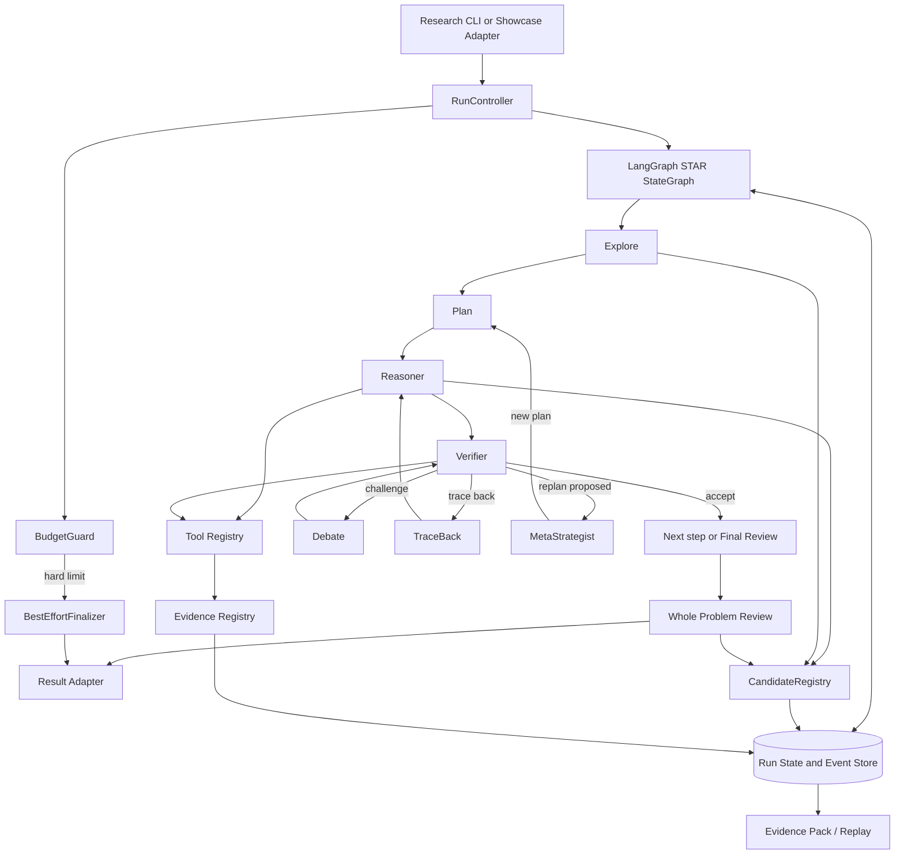
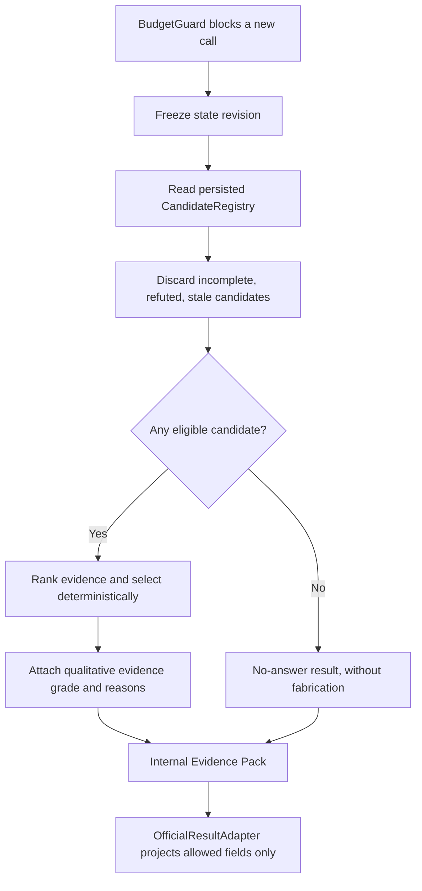

# STAR Core 技术设计：基于 MathAgent 的可恢复数学 Agent 底座

> 文档类型：技术设计（Technical Design，理解系统如何工作）。  
> 文档 ID：STAR-CORE-TD；版本：1.2；日期：2026-10-22；状态：**建议方案，尚未在用户本地仓库实现**。  
> 对应产品需求：[`STAR_CORE_PRD_HUMAN_v1_2.md`](STAR_CORE_PRD_HUMAN_v1_2.md)。  
> 对应编码规格：[`STAR_CORE_SPEC_AGENT_v1_2.md`](STAR_CORE_SPEC_AGENT_v1_2.md)。  
> 范围：完整 STAR Core 的新底座，外加可单独关闭的 Best-Effort Finalization。  
> 约束：只在独立研究 Profile 中运行。不修改 `user_agent.py`、`implementations/` 或当前官方默认调用预算。

## 1. 这份设计解决什么问题

`MathAgent/develop` 已有一条经过保护的官方答题入口，也有独立的数学 Agent 展示工程。新 STAR Core 不应取代这些现有系统，而应作为研究侧车复用其可用基础设施。

我们需要同时做到两件事：

1. 尽可能忠实地实现 STAR 的探索、规划、推理、审查、连续辩论、Trace-Back、Meta 重规划、记忆和整题审查。
2. 在比赛限制下，选用有记录支持的最佳候选答案。系统在硬预算耗尽后不得再调用模型来编造解释或补写证明。

前者是 **STAR 机制复现目标**；后者是 **[本项目扩展]**。两个目标必须可以分别评估。技术设计不能把工程正常运行等同于数学正确率提高。

### 1.1 来自仓库的已确认事实

截至 2026-10-22，对公开 `develop` 分支的核对发现：

| 层次 | 当前仓库事实 | 对本设计的影响 |
| --- | --- | --- |
| 运行环境 | `pyproject.toml` 要求 Python `>=3.11,<3.13`，项目使用 `uv` | 优先支持 Python 3.11 与 3.12，不为了追新语法抬高全仓 Python 下限 |
| Agent 依赖 | `showcase` 与 `dev` 已锁定 `langgraph==1.2.15`、`deepagents==0.7.25` | 沿用 LangGraph，无需另装第二套流程编排运行时 |
| 官方入口 | `user_agent.ReasoningAgent(client=...).solve(problem, metadata)` 返回 JSON 字典，含非空 `final_response` | 新系统写独立 Runner 和输出适配器，默认不导入官方入口 |
| 产品状态 | v0.1 能力报告列出 SQLite Run、Checkpoint、动态循环、Tool Registry 和 Evidence Pack 的离线验收 | 尽量复用这些接口，不平行制造第二个产品级 Run Manager |
| 工具状态 | Python 工具为实验能力，真实 Intern 工具调用在能力报告中仍需验证 | 不默认宣称任意代码沙箱已经生产可用 |
| v0.2 规划 | 当前 v0.2 文档处于 DRAFT / proposed，设计包括 Flask、Job、SSE 与 `polynomial_check` | 视为未来兼容目标，不把尚未实现的功能写成已交付 |
| 比赛边界 | `AGENTS.md` 要求新增模块默认关闭，不能改变官方路径 | 原生 `official` 不得因 STAR 研究代码增加任何调用或依赖副作用 |

来源：[MathAgent AGENTS.md](https://github.com/RUSS0718/MathAgent/blob/develop/AGENTS.md)、[pyproject.toml](https://github.com/RUSS0718/MathAgent/blob/develop/pyproject.toml)、[v0.1 能力基线](https://github.com/RUSS0718/MathAgent/blob/develop/docs/evals/v0.1-capability-baseline.md)、[v0.2 PRD](https://github.com/RUSS0718/MathAgent/blob/develop/docs/prd/subjective-agent-platform-prd-v0.2.md)。这是一份公开分支快照，不是本地工作树的逐文件审计；实际开发前必须记录当前 commit，并重新检查新增文件的重名风险。

### 1.2 不做什么

本阶段不做 Danus 的完整事实图、SHEAF 的 Lean DAG、OSVerify 的额外验证器、Moonshine 的猜想生命周期、PackingStar 的构型训练器、跨不同题目的长期学习和训练基础模型。它们可在以后的实验中通过扩展接口加入。

## 2. 架构决策：以 LangGraph 为控制平面

**决策 TD-01：Python + LangGraph StateGraph + Pydantic v2 + 现有模型客户端适配器。**

STAR 的 Python Orchestrator 是确定性的：LLM 负责数学判断，Python 决定哪个阶段可以执行、哪个裁决可以接受、是否还有预算、如何保存或回退状态。LangGraph `StateGraph` 恰好能表达这样的节点与条件边。采用 LangGraph，不是要让模型自己随意 handoff，也不是把全部逻辑放进一个通用 ReAct 循环。

| 可选底座 | 为什么考虑 | 本期决定 |
| --- | --- | --- |
| **LangGraph 1.2.x** | 本仓库已有依赖；有 `StateGraph`、条件边、checkpoint、resume | **主编排器**，固定在仓库当前已验证的 1.2.15，升级要独立测试 |
| DeepAgents 0.7.x | 本仓库已有角色级 Agent 适配能力 | 可作为**单个角色执行器**，不拥有全局路由和独立状态权威 |
| Pydantic AI | 类型化 Agent、工具和多种耐久执行后端 | 可作为未来角色 Adapter 的候选，不在同一 Run 再建第二个状态机 |
| OpenAI Agents SDK | 提供 Agent loop、handoffs、sessions、tracing | 不作为本期主编排器；比赛模型客户端不是必须走该 SDK |
| 自写 Python FSM | 最接近 STAR 原仓库 | 用于验证纯转移逻辑和回归，不替代 LangGraph 的图调度与 checkpoint |

资料：[LangGraph Graph API](https://docs.langchain.com/oss/python/langgraph/graph-api)、[LangGraph Persistence](https://docs.langchain.com/oss/python/langgraph/persistence)、[Pydantic AI](https://pydantic.dev/docs/ai/overview/)、[OpenAI Agents SDK](https://openai.github.io/openai-agents-python/)。使用某个框架**不能替代**状态与预算的应用层约束。

**决策 TD-02：Pydantic 只负责契约。** 使用 Pydantic v2 模型验证 Verifier、Meta、Candidate 和 Result 等边界对象。运行中的 LangGraph State 可以采用 `TypedDict`，并在节点提交前调用 Pydantic 校验。不要把一次模型自由文本判为一个合法的 `ACCEPT`。

**决策 TD-03：不增加第二套通用 Agent Loop。** DeepAgents 或其他 Agent SDK 若在局部节点内使用，必须透过 `RoleExecutor`，由上层 `BudgetGuard` 和 `ToolPolicy` 统一限制循环次数及费用。

## 3. 总体组件和数据流



图中的 `BestEffortFinalizer` **不调用 LLM**。预算耗尽时所有在途任务都停止向权威状态提交新结果，只有已落库、满足选择合同的候选可以被选中。将来如接入 Showcase Job，由既有运行管理器持有 Job 生命周期，不由 Agent 图另外创建 Job。

### 3.1 谁能修改什么

| 对象 | 只读消费者 | 唯一写入责任 |
| --- | --- | --- |
| 原题、计划、当前步骤和 Run 状态 | 三个角色、工具适配器 | `RunController` 的事务更新 |
| Reasoner 会话历史 | 当前 Reasoner | `SessionManager` 通过已完成调用记录维护 |
| Verifier 单步骤辩论历史 | 当前 Verifier | `SessionManager` |
| Meta 跨尝试历史 | Meta | `SessionManager` |
| 候选答案账本 | `BestEffortFinalizer`、Verifier | `CandidateRegistry`，并由状态事务持久化 |
| 证据与失效信息 | Reasoner、Verifier、Meta、评测器 | `EvidenceRegistry`，并由状态事务持久化 |
| 全局预算 | 所有角色 | `BudgetGuard`，模型与工具适配器执行强制检查 |

LLM 只能提交结构化候选更新。LLM 不能直接修改 SQLite、重置预算、标记自己已经被验证，或通过自然语言绕过状态路由。

## 4. 主流水线与状态转移

图节点应对应可观测的业务操作，而不只是提示词角色。核心顺序如下：

```text
setup -> optional preplan -> exploration
  -> early whole-review when solved
  -> planning -> step_reason -> step_verify
  -> [accept | challenge | traceback | propose_replan]
  -> [next step | debate | rollback | meta_decision]
  -> whole-finalize -> whole-review -> terminal

At every call boundary:
  BudgetGuard -> continue OR best_effort / terminal
```

具体转移由 `StateRouter` 的纯函数决定。它只读取已验证的结构化裁决及状态，不调用模型。

| 当前阶段 | 事件或裁决 | 下一阶段 | 状态副作用 |
| --- | --- | --- | --- |
| `EXPLORE` | `SOLVED` | `EXPLORE_REVIEW` | 保存探索报告和候选 |
| `EXPLORE_REVIEW` | `ACCEPT` | `TERMINAL` | 保留完整候选及审查引用 |
| `EXPLORE_REVIEW` | 不通过 | `PLAN` | 保留探索成果，不标记已证 |
| `PLAN` | 合法计划 | `STEP_EXECUTE` | 版本化步骤计划 |
| `STEP_VERIFY` | 两个 Gate 通过，裁决 `ACCEPT` | 下一步或 `FINAL_GENERATE` | 保存审查与接受结果 |
| `STEP_VERIFY` | `CHALLENGE` | `CHALLENGE` | 本步双角色续接历史 |
| `STEP_VERIFY` | `TRACE_BACK` | `TRACE_BACK` | 归档并失效下游依赖 |
| `STEP_VERIFY` | `PROPOSE_REPLAN` | `META_DECIDE` | 提交失败摘要 |
| `META_DECIDE` | `APPROVE_REPLAN` | `REPLAN` | 归档计划、保留失败与救援结果 |
| `REPLAN` | 允许受限再探索 | `POST_REPLAN_REEXPLORE` | 将探索候选追加到账本 |
| `FINAL_VERIFY` | `ACCEPT` | `TERMINAL` | 保存整题证据，不等同 Lean 证明 |
| 任一可调用阶段 | 硬预算不足 | `BEST_EFFORT` 或 `TERMINAL` | 使用本地候选和证据，零新增模型调用 |

Trace-Back 的决策可由 Verifier 或 Meta 提出，但归档、依赖失效、会话换代和当前步骤移动都由 Python 执行。这里不会专门调用一个“回退 Agent”。

### 4.1 控制流程必须保持的 STAR 特征

覆盖 SC-001..SC-038，包括：探索完成时的提前整题审查、预计划 Meta 提示、结构化规划、三类验证标签、`Goal Gate` 和 `Logic Gate`、多轮有状态辩论、定点 Trace-Back、Meta 持久会话、三类故障诊断、强制禁用代码的纯推理模式、再探索委派、整题审查以及七个按需数学 Skill。详见 PRD，本文不复制完整 Prompt 文本。

### 4.2 受限 Profile 不等于完整 STAR

`star_reference` 以控制协议保真为目标，可使用较长预算，但不得声称使用与论文完全相同的模型或 Copilot CLI 平台。`star_best_effort` 基于相同 STAR 控制流，额外开启候选账本选择。`competition_constrained` 从仓库当前评测合同读取预算，在运行时可能提前终止，不得把其结果标为完整 STAR 复现。`official` 完全走原入口。不同 Profile 的模型、额度和工具权限都写入运行清单。

## 5. 包结构与当前仓库的衔接

本设计**建议**扩展独立实验包 `harness_lab/star_core/`。上一轮对话交付过 `harness_lab` 侧车 ZIP，但公开仓库并不保证已合入该目录。实施时先核对本地工作树；若已经存在 `harness_lab`，在不破坏其公开 API 和测试的前提下增量演进。文件树是目标布局，不是现存文件清单。

```text
MathAgent/
  user_agent.py                 # Existing: must remain unchanged
  implementations/             # Existing: official baseline
  pyproject.toml                # Existing: optional research deps only
  harness_lab/
    star_core/
      api.py                    # ResearchHarness public facade
      graph.py                  # StateGraph and conditional routing
      transitions.py            # Pure routing and invariants
      schemas.py                # Pydantic contracts
      context_views.py          # Role-specific state projections
      roles.py                  # Reasoner, Verifier, Meta wrappers
      sessions.py               # Session lifecycle and transcript refs
      memory.py                 # Positive and negative evidence ledgers
      candidates.py             # Append-only candidate registry
      best_effort.py            # Pure candidate selection
      evidence.py               # Evidence and confidence policy
      budget.py                 # One shared budget ledger
      storage.py                # Repository and event transaction boundary
      tools.py                  # Tool Registry adapters and permissions
      model_port.py             # Contest client and provider adapters
      profiles.py               # Reference and ablation profiles
      official_adapter.py       # Contract-preserving result projection
      phases/                   # Explore, plan, step, review, debate, rollback, meta, final
      prompts/                  # Role prompts and versioned policies
      skills/                   # Seven on-demand STAR protocols
  tests/
    test_star_core_*.py          # Contract and failure-injection tests
  artifacts/                     # Ignored runtime outputs
```

不要直接创建新的 `showcase` 服务端、数据库登录层或 SSE 服务。若已有 Showcase `RunRepository`、`ToolRegistry`、`EvidenceExporter` 可满足合同，先写 Adapter 复用它们，再新增必要字段或表。若兼容性不足，单独记录差异与迁移方案，不要静默拥有两份独立真相。

## 6. 状态、持久化和记忆

### 6.1 区分四种 ID

- `chat_session_id`：Showcase 用户可见的会话。**同一 ChatSession 可以包含多个题目 Run。**
- `run_id`：一次解题执行。它是预算、状态、候选和权限的隔离单位。
- `graph_thread_id`：LangGraph checkpoint 的 thread 标识。研究侧默认由 `run_id` 派生，必须保持稳定且不可串题。
- `role_session_key`：一个角色的对话历史范围。Meta 在同一 Run 中持久，Reasoner 在一个 Plan Attempt 内持续，Verifier 仅在同一步辩论持续。

**题目级持久记忆可以跨 Role Session，但不得自动跨数学题共享。** LangGraph Checkpointer 保存 Run 内的执行进度；它不是跨所有题目的知识库。LangGraph `Store` 支持跨线程数据，但不在本项目的 STAR 参考 Profile 默认启用。参见 [LangGraph Persistence](https://docs.langchain.com/oss/python/langgraph/persistence)。

### 6.2 状态的单一权威源

本方案以现有产品层的 `RunRepository` 和事件日志为**业务权威记录**；Graph Checkpointer 负责执行恢复与局部状态快照。二者是不同用途，不能直接当作两份可写、互不协调的 `ProblemState`。

必须设置 `state_revision`，把 Graph checkpoint 对应的 `run_id`、`revision` 与业务事件相互关联。可采用同一 SQLite 文件中不同表的事务化提交；若 Checkpointer 无法与现有 Repository 加入同一事务，则采用显式的完成标记、对账与恢复规则。**不允许把“写了两套 SQLite”解释成天然原子事务。**

建议的权威业务表：

| 表或实体 | 唯一键 | 内容 |
| --- | --- | --- |
| `runs` | `run_id` | 题目哈希、Profile、状态、计划版本、预算汇总 |
| `run_events` | `(run_id, event_id)` | 单调序号、事件类型、阶段变化、裁决引用 |
| `role_sessions` | `role_session_key` | 角色、attempt、step、provider session 绑定或消息日志引用 |
| `candidate_versions` | `candidate_id` | 候选文字、来源、状态、版本、证据与失效信息 |
| `evidence_items` | `evidence_id` | 工具和审查证据、适用范围、来源 |
| `model_calls` | `call_id` | 发起时间、未知结果、provider usage 与失败类型 |
| `artifacts` | `artifact_id` | 步骤报告和回放文件的内容哈希与位置 |

SQLite 是本地 Run 存储与实验规模的首选；只有跨进程并发和部署需要明确时，才评估 Postgres。不要因为 LangGraph 支持 Postgres 就立即启动远程服务。测试 checkpoint 后端与业务表的写入次序时，必须进行故障注入。

### 6.3 会话与四层记忆

| 记忆层 | 发生什么 | 什么时候结束 |
| --- | --- | --- |
| Reasoner 计划尝试 | 连续保存执行步骤、修复和辩论相关信息 | Trace-Back 或 Re-plan 后换代，旧历史归档 |
| Verifier 步骤辩论 | 同一步的指控、回应和修订连续可见 | 切到下一步骤或整题审查时重建 |
| Meta 研究策略 | 记住整道题跨计划的失败和复用成果 | Run 完结后结束 |
| Orchestrator 状态账本 | 已接受结论、失败方向、工具证据和版本 | Run 永久留档，直到显式清理 |

每次角色调用前，从同一 `ProblemState` 生成**只读状态投影**；投影包含足够的最新增量，而不是重新塞入所有聊天记录。模型发出的原始裁决需要 Schema 校验，才能变成状态事件。Trace-Back 后必须撤销不再成立的知识引用，而不是删光失败档案。

### 6.4 Session 绑定示例

```python
# Illustrative contract; not a claim that these functions exist today.
role_session_key = make_session_key(
    run_id=run_id,
    role="verifier",
    plan_attempt=attempt_index,
    step_id=current_step_id,
)
context = context_projector.for_verifier(state, role_session_key)
response = model_port.call(role="verifier", messages=context.messages)
verdict = VerifierDecision.model_validate(response.parsed_output)
run_controller.commit_verdict(verdict, expected_revision=state.state_revision)
```

对于仅接受完整历史的模型客户端，可由 `SessionManager` 重建消息列表。对于支持原生 resume 的模型服务，仍要校验 `provider_session_id`、题目 ID、角色 ID 和计划版本，并注入最新问题状态。

## 7. 模型 Adapter 和输出合同

模型后端由 `ModelPort` 接口隔离。新的 LangGraph 不能把 Intern 服务的 `client.chat(...)` 当作自身内置的模型类。官方 `client.chat(messages, temperature, max_tokens, thinking_mode)` 可由薄适配器封装，而不修改原客户端。

```python
from typing import Protocol
from pydantic import BaseModel

class ModelRequest(BaseModel):
    run_id: str
    call_id: str
    role: str
    messages: list[dict[str, str]]
    model_id: str
    temperature: float
    max_output_tokens: int
    thinking_mode: str | None = None

class ModelReply(BaseModel):
    text: str
    provider_request_id: str | None = None
    input_tokens: int | None = None
    output_tokens: int | None = None
    finish_reason: str | None = None

class ModelPort(Protocol):
    def complete(self, request: ModelRequest) -> ModelReply: ...
```

上面是示例类型，必须与本地 `client.chat` 的真实返回形态对齐。部分客户端只返回正文；此时用量字段必须为 `None`，而不是 0 或按字符估计的假精确 Token。

结构化裁决通过 Pydantic 校验。提供商若支持结构化输出，可优先使用；不支持时从受限格式解析，再作严格验证。解析失败属于 `PARSE_ERROR`，绝不能降级成 `ACCEPT`。

模型调用层要记录逻辑调用数、物理 HTTP 尝试数、重试次数、完成原因、延迟和预算检查结果。不要把调用重试隐藏在模型适配器内部，使 `BudgetGuard` 无法计数。

## 8. 预算、候选答案和 Best-Effort Finalization

### 8.1 预算是调用前的硬门禁

`BudgetGuard` 对所有角色和委派子任务共享同一个 Run 预算。它管理：最大逻辑模型调用数、真实完成输出额度、工具调用数、单工具超时、总墙钟截止时间，以及可选的费用限制。无法获取真实 Token 时写 `null`，但仍严格执行模型调用次数与时间上限。

预算应有“软收束线”和“硬截止”两个概念。接近软收束线时，系统可以使用**剩余合法额度**提前整理完整候选。达到硬截止后，只能进行本地选择和结果投影。外部评测 Runner 若会直接杀死进程，系统无法保证在硬截止之后还获得执行时间；因此应在截止前保留确定性的结果写入余量。这个余量应由本地延迟测量决定，不硬编码成声称通用的秒数。

### 8.2 为什么必须持续保存候选

预算可能在任何模型调用中耗尽。候选不能等到 `FINAL_GENERATE` 才第一次保存。

- Explore 阶段如有完整答案，存候选，保留验证状态。
- Reasoner 的一个步骤如果已经给出完整答案，可存候选，但标记来源和仍缺的证明。
- Finalize 输出完整答案，存新候选版本，不能覆盖此前通过审查的旧版本。
- Verifier 反驳某候选后，保留该版本但取消其选择资格。
- Trace-Back 或 Re-plan 撤销关键前提后，所有依赖该前提的候选必须失效。

核心规则：**只选择完整、可解析、没有决定性反证且依赖仍有效的候选**。如果只有半段推理，不得自动提取一个看起来像数字的文本当作答案。

### 8.3 候选和证据的数据合同

```python
from enum import StrEnum
from pydantic import BaseModel, Field

class CandidateStatus(StrEnum):
    DRAFT = "draft"
    ELIGIBLE_UNREVIEWED = "eligible_unreviewed"
    LOCALLY_REVIEWED = "locally_reviewed"
    WHOLE_REVIEWED = "whole_reviewed"
    REFUTED = "refuted"
    INVALIDATED = "invalidated"

class ConfidenceLevel(StrEnum):
    HIGH = "high"
    MEDIUM = "medium"
    LOW = "low"
    REJECTED = "rejected"

class CandidateRecord(BaseModel):
    candidate_id: str
    run_id: str
    problem_hash: str
    answer_text: str
    source_phase: str
    plan_version: int
    step_refs: list[str] = Field(default_factory=list)
    created_event_id: str
    answer_completeness: str
    review_state: CandidateStatus
    evidence_refs: list[str] = Field(default_factory=list)
    invalidated_by: list[str] = Field(default_factory=list)
    known_objections: list[str] = Field(default_factory=list)
    selection_eligible: bool

class BestEffortDecision(BaseModel):
    status: str
    selected_candidate_id: str | None = None
    confidence_level: ConfidenceLevel | None = None
    reason_codes: list[str] = Field(default_factory=list)
    evidence_refs: list[str] = Field(default_factory=list)
    unresolved_issues: list[str] = Field(default_factory=list)
    excluded_candidate_ids: list[str] = Field(default_factory=list)
    selection_rule_version: str
    termination_reason: str
```

这些类型是设计示意，开发时应统一 Schema 到单个定义位置，禁止在 Graph、API 和存储层重复定义同名却不同义的模型。

### 8.4 证据排序和置信等级

候选选择过程必须是**可重放、确定性且无 LLM 调用**的纯逻辑。

选择流程：

1. 排除 `draft`、`refuted`、`invalidated`、不完整或不符合输出合同的候选。
2. 检查候选依赖的所有活动步骤与 Evidence 是否仍有效。
3. 先比较整题审查的证据，再比较独立且适用的工具证据，再比较局部审查。最后才使用未审查的完整候选。
4. 对同级候选使用公开的确定性平局规则，例如排序稳定键。若不同候选答案可能语义等价但无法确证，也不能随意当作已知冲突或已知相同。
5. 生成证据等级、理由代码和未解决疑点。禁止把“模型说自己 95% 确定”写成可靠的概率。

`high` 必须要求完整答案经过整题审查、具有适用的独立支持且无未解决实质疑点；`medium` 允许整题证据不足但有有效推导；`low` 对应关键缺证或不可解的答案冲突；`rejected` 永远不参与选择。这是**证据等级**，不是正确概率的校准值。不能因为一次算术检查成功就提升为整题已证明。

### 8.5 预算耗尽的数据流



**已发起但尚未确认完成的外部请求**可能已消耗供应商额度。系统记录 `unknown_outcome`，并禁止迟到的响应修改已经冻结的终态。自动重试必须先经过可查证的幂等与预算策略，不能假定“没收到响应”就等于“没计费”。

### 8.6 对外答案与内部证据分离

```json
{
  "final_response": "42",
  "status": "partial_budget_exhausted",
  "best_effort": {
    "status": "candidate_selected",
    "selected_candidate_id": "cand-07",
    "confidence_level": "medium",
    "reason_codes": ["local_review_accepted", "whole_review_missing"],
    "unresolved_issues": ["边界情况尚未检查"],
    "evidence_refs": ["review-step-03"],
    "selection_rule_version": "best-effort-v1",
    "termination_reason": "model_call_budget_exhausted"
  }
}
```

这是**内部研究结果**的格式，不是默认官方 JSON 结果。`OfficialResultAdapter` 必须以当前 `AGENTS.md` 允许的字段为准。例如，若正式合同只承认 `final_response` 和 `trace`，则不得擅自将 `best_effort` 元数据写到根 JSON 中；内部结果与 Evidence Pack 仍保留完整记录。

无合格候选时，内部返回 `best_effort.status=no_eligible_candidate`。比赛适配器按实际合同输出一个非空但明确表示未求得答案的文本，并将其计入**无数学候选**，而不是将其计为答对。

## 9. 数学工具与 MCP 接口

STAR 的核心并不依赖 Lean。当前阶段首先复用仓库已有 `Tool Registry`、SymPy 与 mpmath 能力。代码执行必须进入明确的受限运行环境；现有 AST 或子进程约束不应被称为生产级安全沙箱。

每个工具必须给出：调用前提、输入 Schema、输出 Schema、适用范围、超时、最大输出大小、是否有副作用、Evidence 类型与验证等级。未知、超时和不适用是三个不同结果。

**MCP 定位：未来工具适配器，而不是第二个 Agent 总指挥。** 工具注册层可以统一封装本地 Python 工具与远程 MCP Tool。运行时仍必须经过 `ToolPolicy` 检查权限、限额和操作范围。2026-07-28 MCP 规范引入无状态协议核心，不能把 MCP 连接的 session 与 STAR 的题目 Session 混为一谈。参见 [MCP 2026-07-28 Tools](https://modelcontextprotocol.io/specification/2026-07-28/server/tools) 与 [官方发布说明](https://blog.modelcontextprotocol.io/posts/2026-07-28/)。

例如 `polynomial_check` 可以返回“候选根代入检查通过、完整解集未核验”；它不得返回抽象的 `proved=true` 并在整条证明中无限复用。

## 10. 故障恢复、取消与并发

| 情况 | 系统动作 | 不能做什么 |
| --- | --- | --- |
| LLM 审查拒绝 | 保存审查并路由 Challenge、Trace-Back 或 Meta | 当作网络故障重试，或默认 ACCEPT |
| 解析失败 | 有界格式修复或升级 Meta | 以关键词猜测裁决 |
| 工具超时 | 标记 `unknown` 或失败，保存工具操作 ID | 冒充 `[verified]` |
| 模型超时 | 记录 `unknown_outcome`，检查预算，必要时询问 Meta | 假定供应商未计费 |
| 进程重启 | 从已提交事件与 checkpoint 对账后恢复 | 盲目重复有副作用的外部调用 |
| 取消 Job | 阻止新的工具及模型调用，并冻结终态 | 让迟到结果把 canceled 改为 succeeded |
| 硬预算耗尽 | 走本地 Best-Effort 选择或明确终止 | 再调用 LLM 询问置信度 |

异步模型客户端与实际截断机制必须由 Adapter 负责。把阻塞的同步 `chat()` 放进线程不等于可以安全强杀远程请求；若有严格外部墙钟约束，需要在最晚启动门禁或单独的可终止工作进程中处理。这个机制要在真实比赛环境里验证，不能只用假客户端测试代替。

## 11. 观察、实验与指标

建议用 OpenTelemetry 规范记录 Span，保留你们现有脱敏事件和 Evidence Pack 作为产品与评测的真实数据来源。OpenTelemetry 或 LangSmith 可以用于开发期观察，但外部导出关闭时本地测试仍应完整运行。不要向第三方 Trace 系统上传 API 密钥、隐藏答案、完整题目数据或敏感原始思维链。

每个 Run 至少输出：

- `run_id`、题目与数据集版本哈希、源码 Commit、Profile、模型 ID 和推理参数。
- 各角色调用次数、真实输入输出 Token（可得才记录）、实际工具次数、调用延迟和停止原因。
- 各阶段耗时、Challenge 次数、Trace-Back 次数、Re-plan 次数、候选数量和拒绝原因。
- 候选交付状态、题目正确率、`pass@budget`、无效 JSON 率、预算耗尽率和恢复成功率。
- 置信等级的分组实际正确率，评价其是否对风险有提示价值；不把等级当成已经校准的概率。

消融比较要控制题目、模型、模型版本、Prompt 版本、工具权限、最大调用量和墙钟预算。`star_reference` 与 `star_best_effort` 的机制差异要单独统计；不能把后者的兜底改善说成原版 STAR 的提升。若模型不提供 Token 用量，论文表格该格应写 `unknown`，而不是用字符数量冒充。

## 12. 实施顺序与验收门槛

每个阶段按你们仓库的 `AGENTS.md` 采用短分支、先写失败测试、最小切片实现、聚焦测试、完整回归和 diff 审查。只有具备实际测试证据的模块才能标成已实现。

| 阶段 | 主要工作 | 验收门槛 |
| --- | --- | --- |
| T0 | 本地仓库与来源 Commit 审查 | 官方入口 SHA-256 冻结，源版本和现有路径记录完成 |
| T1 | ModelPort、Pydantic Schema、BudgetGuard | 结构化裁决严格校验，调用计数准确，未提供 Token 保留 `null` |
| T2 | SQLite Repository、Checkpointer、SessionManager | 事件/快照恢复一致，题目与角色严格隔离 |
| T3 | 完整 STAR Explore、Plan、Step、Verify | Gate、标签预检、提前结束与非法计划有测试 |
| T4 | Challenge、Trace-Back、Meta、Re-plan | 连续辩论保留上下文，失效传播，持久 Meta 和纯推理工具禁用 |
| T5 | Skills、后重规划委派、最终整题审查 | 完整核心 SC-001..SC-038 / AC-01..AC-33 行为可离线复核 |
| T6 | CandidateRegistry 与 BestEffortFinalizer | SC-039..SC-043 / AC-34..AC-44 通过；硬限后零调用 |
| T7 | Showcase Adapter 与实验配对 Runner | 原 `official` 未变，实验回放无模型或工具调用 |
| T8 | 真实 Intern 与消融测试 | 单独记录 Live 成功、调用与成本和数学正确率，不挪用离线结果 |

先行的本地检查应沿用仓库已有命令：

```bash
python -m unittest discover -s tests -p "test_*.py"
python scripts/check.py --offline
python scripts/check_showcase_release.py
```

这些命令来自公开仓库文档，实施前仍要核对当前目录和依赖安装；新测试文件不应覆盖已有测试。对于新增第三方库，只添加在 `pyproject.toml` 的实验可选依赖组，使用 `uv lock` 产生固定、可复现的解析结果；不要仅在技术文档里写“安装最新版”而不提交锁文件。若 LangGraph 版本与现有 `deepagents` 锁定值冲突，优先保护现有运行路径，再通过单独的依赖升级实验解决。

## 13. 风险和替代方案

| 风险 | 可观察信号 | 应对 |
| --- | --- | --- |
| 两套状态不一致 | Graph 看见已接受，Repository 未提交 | 单一权威事务、修订号、恢复时对账 |
| 角色上下文串题 | Verifier 读到上一题材料 | `run_id` + role-scoped session key；强制隔离测试 |
| Meta 把推理变成长时间空转 | Challenge 和 Re-plan 累积到上限 | 有界转移、统一预算、可用候选提前落盘 |
| 新组件挤占比赛调用 | 开启 Profile 后常规求解缩短 | 独立 Profile、配对实验、软收束线 |
| 置信度虚高 | high 候选错误率仍高 | 定义为证据等级，附理由，离线校准前不输出数值 |
| 不完整答案被选中 | 流式输出截断、只有中间数字 | 候选完整性门禁；必须可追溯 |
| 模型超时造成重复计费 | 发生无返回的远端调用 | `unknown_outcome` 与请求 ID；禁止盲重试 |
| 远程工具输出污染上下文 | 工具文本包含诱导控制命令 | 工具输出是数据，控制仅来自结构化、受验证的角色裁决 |

## 14. 文档之间如何协作

- **产品 PRD** 规定系统应当对用户表现什么行为，尤其是 SC-039..SC-043。
- **Agent 实施规格** 规定 Schema、动作边界、需求测试和实现阶段。
- **本技术设计** 说明为何选这些技术，以及如何接入现有仓库。

出现冲突时，以比赛正式合同和本地 `AGENTS.md` 为最高约束；两份 PRD 的共同需求编号定义期望行为；技术示例不可推翻验收合同。先记录冲突，再修改规范，不能让编码 Agent 自行臆测产品意图。

## 15. 参考资料

- [STAR-PólyaMath 论文与附录](https://arxiv.org/html/2605.19338)。STAR 的角色、控制流与记忆策略来源。
- [STAR 官方仓库](https://github.com/Julius-Woo/STAR-PolyaMath)。实现前记录具体 Commit，再逐函数对照。
- [MathAgent 开发约束](https://github.com/RUSS0718/MathAgent/blob/develop/AGENTS.md)。官方入口与实验隔离的依据。
- [MathAgent 现有技术栈](https://github.com/RUSS0718/MathAgent/blob/develop/pyproject.toml)。Python、uv、LangGraph 与 DeepAgents 版本来源。
- [MathAgent v0.1 能力基线](https://github.com/RUSS0718/MathAgent/blob/develop/docs/evals/v0.1-capability-baseline.md)。对已实现与未验证能力的边界说明。
- [MathAgent v0.2 规划](https://github.com/RUSS0718/MathAgent/blob/develop/docs/prd/subjective-agent-platform-prd-v0.2.md)。仅作为后续产品侧的兼容目标。
- [LangGraph StateGraph](https://docs.langchain.com/oss/python/langgraph/graph-api) 和 [Persistence](https://docs.langchain.com/oss/python/langgraph/persistence)。
- [MCP Tools 2026-07-28](https://modelcontextprotocol.io/specification/2026-07-28/server/tools)。未来 MCP Adapter 的协议参考。
- [Cursor technical-writing](https://github.com/cursor/plugins/blob/main/pstack/skills/technical-writing/SKILL.md)。本文采用明确术语、单一文档模式、具体契约及可验证陈述。

> 本文没有在用户本地 `MathAgent` 工作树执行安装、迁移或真实模型评测。源码中引述的版本与能力来自 2026-10-22 的公开 `develop` 分支快照；实施结果需在具体 Git Commit 下独立确认。
