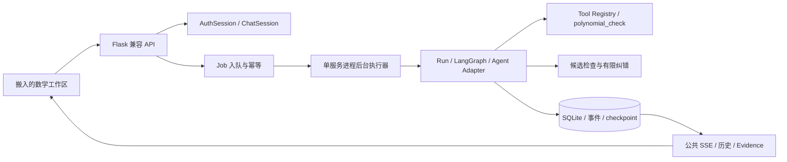

# MathAgent Workbench v0.2 PRD Lite

> **状态：** `superseded by v1.1`。本文保留为历史版本，不作为当前开发合同；当前合同见 [`showcase-solver-harness-v1.1-spec.md`](../specs/showcase-solver-harness-v1.1-spec.md)。

文档职责：定义 v0.2 的用户价值、前后端范围、能力升级与可执行验收目标。

适用范围：`showcase_mvp` 产品侧；供需求评审、风险验证和下一步技术设计使用。

**状态：DRAFT，已完成需求共识确认；不是开发授权或已实现能力声明。**
**日期：** 2026-10-16（Asia/Shanghai）
**版本主题：** 从可恢复的 Run 骨架，走向可交互、可复核的数学工作台。
**前端范围：** 将 `D:/project/CausalAgent-demopaper/chat-frontend` 搬入 `showcase/frontend/chat-frontend/`，在本仓库维护数学工作区。
**事实依据：** [v0.2 规划调研](../research/v0.2-planning-baseline.md)、[v0.1 能力基线](../evals/v0.1-capability-baseline.md)、[文档索引](../README.md)。

## 1. 版本判断与产品目标

v0.1 的开发任务已经收尾，Run、SQLite、动态执行循环、工具注册、恢复和 Evidence Pack 有离线验收依据。真实文本与最小 PNG 请求可达，但产品真实工具调用仍没有通过当前能力报告的 live 验收，数学正确率提升也没有独立测量。这是 v0.2 的起点。

v0.2 解决三个用户问题：长任务只能等待同步响应、已有记录不便在工作区操作、答案与工具检查的关系不清楚。完成后，用户可以在同一个数学会话中提交题目、观察真实执行、处理复核、刷新恢复，并看到答案经过了哪些检查及其限制。

本版的能力升级是“**候选答案 → 有适用域的检查 → 一次有限纠错或人工复核 → 带证据交付**”。它承接 v0.1 的 VerificationHook，不预设正确率提升。

## 2. 领域语言与产品边界

| 术语 | v0.2 含义 |
| --- | --- |
| `AuthSession` | 把请求绑定到本机单用户身份的认证会话。 |
| `ChatSession` | 用户可见的一段数学对话，包含问题、答案和对应运行记录。 |
| `Run` | 一次隔离的数学任务执行，拥有阶段、状态、checkpoint 和产物。 |
| `Job` | 前端观察和控制一次 Run 的异步对象，支持 SSE、resume、cancel 和幂等重试。 |
| `Stage` | Run 内可恢复的阶段，例如 planning、solving、verifying。 |
| `Evidence Pack` | 答案、公开摘要、检查、工具调用、错误和恢复事件的脱敏导出包。 |

v0.2 只交付本机 loopback 单用户工作区。后端首次访问时创建或恢复一个本地用户和 `AuthSession`，不提供注册、账号管理或公网部署。logout 清除当前 Cookie；新的 `AuthSession` 仍可读取同一用户的历史 `ChatSession`。这套身份边界不进入 `official` Profile。

`official` 继续只运行根 `user_agent.py` 和现有 baseline。`showcase_mvp` 承载 Flask、前端、SQLite、后台执行、工具、检查和导出。长期记忆、搜索、多 Solver、Debate、Reflection、RSI、MCP 扩展、分布式执行和生产代码沙箱不属于 v0.2。

## 3. 用户与核心路径

| 用户 | 需要完成的事 |
| --- | --- |
| 演示者 / 评委 | 在 3–5 分钟内看懂一次真实数学任务、工具使用、检查和故障处理。 |
| 数学任务使用者 | 输入文本题，得到公式可读、检查范围清楚的解答，并继续追问。 |
| Agent 工程师 | 通过 Run ID 定位模型、工具、预算与失败，导出并复现已观察结果。 |

核心 P0 路径：进入本地工作区 → 新建 `ChatSession` → 输入文本题 → 创建 Job 并立即获得 ID → 查看阶段、工具和检查状态 → 查看答案与 Evidence → 必要时补充条件、重试或人工恢复 → 导出；刷新和切换会话后仍能回到同一条记录。

同一 `ChatSession` 的新问题创建新 Run。对 `waiting_input` 的回答恢复原 Run。修改原题条件必须创建新 Run 并关联来源，不能继续使用旧条件下已经产生的检查结果。

## 4. 前端范围

前端基于 CausalAgent 的 Vue 3、TypeScript、Pinia、Zod、Job runtime、fetch + ReadableStream SSE 和会话地址规则。源仓库使用 MIT License；搬入时保留版权与许可证文本，并记录来源 commit。前端代码放在 `showcase/frontend/chat-frontend/`，不进入根 `user_agent.py` 的导入链。

| ID | 优先级 | 要求 | 用户可见结果 |
| --- | --- | --- | --- |
| FE-01 | P0 | 搬入完整 chat-frontend 作为基线，再移除因果专属入口、RAG、搜索、管理员入口和因果文案。 | 数学工作区使用 `/dashboard`、`/dashboard/session/<id>`、`/dashboard/settings`。 |
| FE-02 | P0 | 保留会话列表、新建、切换、改名、历史、Job 时间线、等待输入、停止、断线恢复和地址同步。 | 刷新、前进后退和切换会话不会重复答案或串接事件。 |
| FE-03 | P0 | 引入 KaTeX，支持行内 / 块公式、分式、矩阵和长公式滚动。 | 实时结果和历史记录使用同一公式渲染；非法公式保留可读原文。 |
| FE-04 | P0 | 使用 section + markdown 报告块展示答案、公开解法摘要、形式化输入、候选检查和限制。 | 页面不显示“答案已证明正确”，而显示具体检查范围和未核验项。 |
| FE-05 | P0 | 展示 `live`、`fake`、`replay`、`experimental`、`unavailable` 和 `planned` 状态。 | 用户能区分实时调用、离线演示、实验工具和不可用能力。 |
| FE-06 | P0 | 安全渲染数学内容。 | 禁止 raw HTML、脚本和危险链接；公式解析失败不使页面崩溃。 |
| FE-07 | P0 | P1 之前通过 capabilities 隐藏文件上传控件。 | 文件兼容 API 仍存在，但上传返回稳定的 `capability_unavailable`。 |
| FE-08 | P0 | 保留通用设置、报告和 Evidence 入口，移除因果图、RAG、搜索和管理员跳转。 | 页面内容只围绕数学任务、运行状态和证据。 |
| FE-09 | P1 | 单张 PNG 题图预览、移除和重试。 | 浏览器上传的 PNG 进入同一个 Run，并在 Evidence 中只显示资产引用。 |

前端构建使用 `npm ci`、`npm run check` 和 `npm run build`。生产构建使用 `/dashboard-assets/`，开发服务器通过 `/api` 代理到 Flask。MathAgent 维护搬入后的源码和测试；CausalAgent 原仓库不再是 v0.2 运行时依赖。

没有真实文字增量时只显示真实阶段进度和最终结果，不发送或模拟 token 流、隐藏推理或角色调用。

## 5. 后端范围与兼容合同

后端使用 Flask 作为 Showcase 产品入口。现有 `showcase_server.py` 迁移到 Flask 实现，但保留 v0.1 已有路径和响应语义，包括 `/health`、`/api/runs`、Run snapshot、JSON events、resume 和 Evidence；在同一入口新增 CausalAgent 工作区所需的 Session、Job、SSE、capabilities 和 AuthSession 路由。迁移不能改变 `official` Profile。



| ID | 优先级 | 要求 | 必须保持的语义 |
| --- | --- | --- | --- |
| BE-01 | P0 | 持久化 `AuthSession`、`ChatSession`、消息、Run、阶段和输入关联。 | 一个用户问题只关联一个 Run；历史只出现一次。 |
| BE-02 | P0 | `POST /api/agent/jobs` 先入库再返回 `202`，后台继续执行。 | 同一 ChatSession 最多一个活动 Job；创建请求不等待模型。 |
| BE-03 | P0 | SSE 只投影已落库的公共事件。 | 业务事件带正整数 ID；支持 heartbeat、Last-Event-ID、断线续传和重复去重。 |
| BE-04 | P0 | 创建、resume、cancel 使用 UUID v4 `Idempotency-Key`。 | 同键同参数返回原结果；同键异参 `409`；重复请求不新增执行。 |
| BE-05 | P0 | 工具失败、进程重启、人工恢复和逻辑取消可观察。 | 保留失败事件；恢复共享累计预算；迟到结果不能改变已取消或已结束状态。 |
| BE-06 | P0 | 文件 API 保留 CausalAgent DTO。 | P1 前上传能力返回 `capability_unavailable`，不伪装为可用。 |
| BE-07 | P0 | Evidence Pack 和回放使用同一结果源。 | replay 不调用模型或工具；导出不包含凭证、完整 prompt、隐藏答案、完整图片或隐藏推理。 |
| BE-08 | P0 | 健康、capabilities、稳定错误码和 request ID。 | 健康检查不调用模型；不可用能力给出原因和状态。 |

### 5.1 兼容 API 的最小覆盖

| 接口组 | v0.2 范围 |
| --- | --- |
| 工作区 / 身份 | `/dashboard*`、`/dashboard-assets/*`、`GET /api/check_auth`、`POST /api/logout`、`GET /api/setting` |
| ChatSession | `/api/new_chat`、`/api/sessions`、`/api/load_session`、`/api/change_session`、`/api/delete_session` |
| Job | `/api/agent/jobs`、`/api/agent/jobs/active`、`/api/agent/jobs/{id}/events`、`resume`、`cancel` |
| 文件兼容层 | `/api/files`、`/api/upload_file`、`/api/delete_file`；P0 返回空列表或明确 unavailable |
| 数学侧扩展 | `GET /api/capabilities`、旧 `/api/runs/{id}`、`/events`、`/evidence`；Markdown 导出以新增格式参数扩展 |

普通列表保持 CausalAgent 的裸数组 / 元组形状，不能直接换成分页对象。Job 创建响应为 `{success:true,job_id,status:"queued",existing:false}`；同键重放返回 `200` 和 `existing:true`。请求保留 `message`、`session_id`、`input_user_file_id` 和 `web_search_enabled`；搜索能力关闭时传 `true` 返回 `capability_unavailable`，不静默忽略。

创建 Job 可选传入 `verification_mode`：`auto`、`required` 或 `off`，默认 `auto`。`required` 表示该任务必须产生有效的 `polynomial_check` 工具证据；没有合法工具请求时进入 `waiting_input` / `needs-review`。普通不需要工具的题可以在 `auto` 下完成。

### 5.2 状态、身份、存储和安全

内部 Run 状态为 `RECEIVED`、`PLANNING`、`RUNNING`、`VERIFYING`、`NEEDS_REVIEW`、`COMPLETED`、`FAILED`、`CANCELED`；外部 Job 映射为 `queued`、`running`、`waiting_input`、`succeeded`、`failed`、`canceled`。`RESUMED` 是事件，不是新的终态。

`session_id` 是 ChatSession 的 ID；`job_id` 与 `run_id` 使用同一个不透明 ID。Run 由同一进程后台执行器消费，队列和状态落在 SQLite。进程重启后，未完成的远端调用不自动重复提交；任务恢复为 `NEEDS_REVIEW`，等待人工决定。

默认数据库和附件目录为 `artifacts/showcase-v0.2/`，可用环境变量覆盖。ChatSession、事件、checkpoint 和幂等记录在同一 SQLite 中保留，直到用户显式删除或清理 artifacts；幂等记录覆盖完整重试链。

AuthSession 使用 HttpOnly、SameSite=Lax Cookie。`check_auth` 返回 CSRF token；所有状态变更请求发送该 token，后端在路由边界校验。loopback 限制不替代 CSRF 校验。

## 6. 数学工具与验证机制

### 6.1 `polynomial_check` 合同

P0 工具只接受以下结构化输入：

```json
{
  "schema_version": 1,
  "variable": "x",
  "coefficients": ["1", "0", "-1"],
  "domain": {"kind": "real"},
  "candidates": ["1", "-1"]
}
```

`coefficients` 按最高次到常数项排列，使用字符串表示有理数，长度对应一元 1–4 次多项式；不接受前导零、多变量或任意代码。`domain` 支持 `real` 和有理数端点的 `interval`；更复杂的定义域返回 `unknown`。候选根也使用有理数字符串。

工具检查：

1. 每个候选代回后的精确残差；
2. 重复候选；
3. 候选是否满足定义域；
4. 当前输入是否在工具适用范围内。

工具不检查完整解集。结果至少包含 `candidate_status`、`coverage_status`、逐候选检查项、限制和 Evidence ID：

- 候选全部有效：`candidate_status=pass`、`coverage_status=unknown`，界面显示“候选有效，完整性未核验”；
- 候选冲突或重复：`candidate_status=conflict`，保留反例和原候选；
- 形式化失败、定义域超出范围或工具不可用：返回 `unknown`，不改写成 `pass`。

### 6.2 真实工具闭环

必须观察到真实模型发出符合 schema 的工具请求，Registry 执行，模型收到结构化结果后继续生成答案，最终报告关联 Evidence ID。模型文字声称“使用了工具”、程序事后补算或静态工具标签均不满足能力发布门槛。

P0 一条工具路径最多执行一次模型工具请求、一次结果 continuation 和一次工具重试；超出后进入 `needs-review`。产品总预算仍受最多 8 次模型调用、4 次工具调用、1 次重试和 180 秒活动执行上限约束，`resume`、纠错和恢复共享累计预算。

原 `PythonMathTool` 继续标记为 experimental，只用于显式开启的本地演示；它不是 P0 默认数学工具，也不是生产代码沙箱。

### 6.3 有限纠错

`conflict` 最多触发一次 Solver 修正；新候选追加保存，原候选、反例和工具事件保留。复检仍冲突进入 `needs-review`。`unknown` 可以交付“未完成独立核验”的结果，不自动循环修正，也不把人工接受改写为 `pass`。

## 7. 范围优先级与明确不做

P0 是文本工作区、Flask 兼容 API、持久异步 Job、SSE、断线恢复、KaTeX、安全渲染、`polynomial_check`、有限纠错和 Evidence Pack。

P1 是单张 PNG 从上传到 Vision、资产引用和同一 Run 报告。P1 通过前端 capabilities 开启；P0 的文件 API 只提供兼容形状和 unavailable 状态。

本版不加入 JPEG/WebP、多图、PDF/OCR、函数作图、几何编辑、搜索、长期记忆、向量库、多 Solver、Debate、Reflection、RSI、MCP 扩展、分布式调度或任意代码沙箱。

## 8. 验收合同

下列目标是拟议验收条件，不是当前测得结果。离线合同、真实浏览器联调、真实模型能力和数学效果分别出报告。

| ID | 必过验收 | 证据 |
| --- | --- | --- |
| AC-01 | 搬入前端和 Flask 后端完成会话、文本提交、任务进展、答案、刷新与追问；连续 10 轮无串会话 / 重复答案。 | 浏览器记录、ChatSession / Run 关联和事件；可用明确标记的离线 Adapter 验证工程链路。 |
| AC-02 | 模型未返回时创建任务已返回 ID；单用户本机连续 10 次接纳请求均 ≤1 秒。 | HTTP 时序和持久任务记录，不计模型耗时。 |
| AC-03 | SSE 断线续传、UTF-8 分块、重复事件、未知事件、坏包和切换会话按协议处理；刷新不增加模型调用。 | 协议测试和真实浏览器断线 / 切换记录。 |
| AC-04 | 并发重复创建、resume、cancel 只产生一次有效动作；同键异参 409；同 ChatSession 活动冲突 409。 | API 和持久层并发验收。 |
| AC-05 | 工具失败 → checkpoint → 进程重启 → 人工恢复；原成功步骤不重复、原失败保留；取消后迟到结果不改终态。 | 故障注入和真实服务记录；远端执行未知项单列。 |
| AC-06 | 3 道需要计算的文本题，每题 2 次真实 Intern 运行，6 次均有合法工具请求 → Registry 执行 → continuation → Evidence 引用。 | 脱敏 Evidence、模型 / 工具 / 配置版本；无工具事件即不通过。 |
| AC-07 | Checker 至少 18 个独立案例：6 个候选有效、6 个候选冲突、6 个不适用 / 不确定；分别产生 candidate pass、conflict、unknown，不能把错误候选标为通过。 | 独立预期、结构化输入、逐项检查和限制说明。 |
| AC-08 | KaTeX、矩阵、长公式、非法公式、脚本 / 危险链接安全可读；390px / 768px / 1440px 可完成核心操作。 | 前端构建、组件测试和 Chrome / Edge 实际页面记录。 |
| AC-09 | v0.1 `/health`、`/api/runs`、JSON events、resume 和 Evidence 合同在 Flask 迁移后仍可用。 | 旧合同测试和新 Flask 路由测试。 |
| AC-10 | 模式、能力状态、candidate/coverage 状态在 UI、capabilities 和 Evidence 一致；replay 无额外模型或工具调用。 | JSON / Markdown、脱敏检查和回放调用计数。 |
| AC-11 | 官方哈希 / 导入边界、unittest、Demo 合同、仓库检查、前端 `npm run check` 和产品发布门禁通过。 | 现有命令、前端检查、干净环境安装和落盘入口记录。 |

### P1 题图验收

P1 另行验收 3 个真实文字 + 单张 PNG 场景，以及超限、伪 MIME、损坏图和不可用端点。P1 只能证明端到端接入；图形理解和解答正确性需要单独人工核对。

### 数学效果验收

实施前冻结至少 20 道与开发调试分离、人工核验的公开文本题，记录来源与内容哈希。以相同模型快照、相同产品预算和独立 Run 比较 v0.1 与 v0.2；记录答案正确性、工具选择、Checker 覆盖 / 误报 / 漏报、耗时、usage 和失败率。支持域外题目也要保留，避免只展示 Checker 擅长的题。

原题、答案和 raw 只存外部验收目录或忽略的 `artifacts/<run_id>/`；仓库只保存评测协议、题目版本标识、脱敏汇总和可复现命令。小样本结果用于发现回归，不直接宣称普遍能力提升。

## 9. 交付切片与退出条件

| 切片 | 交付内容 | 退出条件 |
| --- | --- | --- |
| S0：设计与风险验证 | Flask 迁移、兼容路由、工具 schema、后台执行 / SQLite、AuthSession / CSRF、KaTeX 安全渲染；技术设计、ADR 和验收用例。 | 高风险路径可复现；失败则收缩本 PRD。 |
| S1：文本工作区 | 搬入前端、ChatSession、异步 Job、持久事件、SSE、历史、模式标签和公式。 | AC-01–04、AC-08、AC-09 通过。 |
| S2：连续运行 | 真实工具 continuation、needs-review、resume、cancel、累计预算和重启恢复。 | AC-05–06 通过。 |
| S3：数学复核 | `polynomial_check`、candidate/coverage 分层、一次纠错、报告和导出。 | AC-07、AC-10 通过。 |
| S4：能力 / 发布收尾 | 独立效果报告、安装回归、3–5 分钟演示、技术报告、证据包和复盘。 | AC-11 与全部 P0 通过；没有 live 工具证据时保留工程预览状态。 |
| P1：题图扩展 | PNG 上传、Vision、资产引用和题图 Evidence。 | P1 题图验收通过，不能用 replay 替代真实接入。 |

开发沿用 failing acceptance → 最小实现 → focused check → relevant suite → diff review 的切片流程。技术设计须冻结 Flask 入口、schema 迁移、幂等保留、执行所有权、超时、前端来源和许可证；任何涉及 `official` 的改动都需要新的边界审查。

## 10. 关键风险与评审重点

- **Intern 工具协议风险：** 如果 S0 无法证明真实 function tool 与 continuation 可用，AC-06 不能放宽成模型文字声称用过工具。
- **形式化提取风险：** Checker 只对结构化输入负责；原题、形式化表达和定义域必须同时展示，避免把提取错误当作数学验证。
- **Flask 迁移风险：** 旧 Showcase 合同必须有回归测试；新 Job/SSE 路由不能改变旧 `/api/runs` 语义。
- **异步恢复风险：** 远端调用结果未知时不自动重复提交；取消是逻辑取消，不能声称一定中止远端请求。
- **前端来源风险：** 搬入 MIT 源码要保留许可证和来源 commit；前端构建依赖只进入 Showcase 产品侧。
- **范围风险：** P0 先形成文本任务的完整可验证路径；PNG、搜索、记忆和复杂协作按后续切片推进。

本版的主要取舍是：用限定域 Checker 和一次纠错形成可审查的数学机制增量，优先完成普通工作区与真实工具链，暂缓开放式解析、长期记忆和复杂协作。能力不足时保留 `unknown`、`needs-review` 或 `unavailable`，不把演示状态写成数学能力结论。
